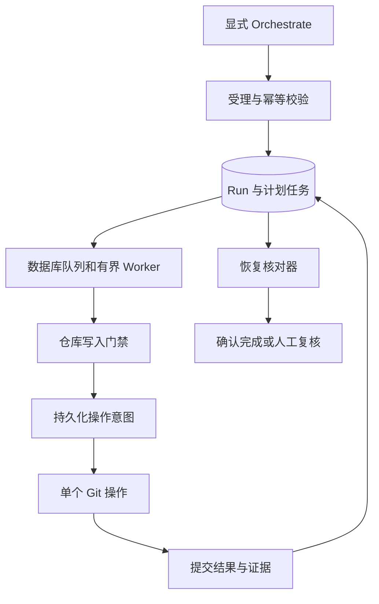

# 发布编排持久执行与中断恢复设计

状态：S1、S2 已于 2026-10-08 完成；2026-11-21 用户授权继续研发和分阶段推送，S3-A/B1、S3-B2、S3-C1 已验收并推送。C1 固定 `e5094ba` 的 Full-Link 44899945002 为 5/5；当前推进 C2-A 持久扫描、异步受理与进度观察，C2-B 再完成已领取任务接管与证据驱动恢复。实际已验收边界见 `s1-implementation.md`、`s2-implementation.md` 及 tasks.md。

## 0. 当前研发蓝图与授权（2026-11-21）

用户已明确授权持续研发、必要重构、分组提交和分阶段推送。项目尚未上线，本轮不保留旧写入口、兼容层或双轨执行；此前 S3–S5“尚未批准”的记录仅是历史状态。实现与验收仍逐切片记录，授权不等于能力已经完成。接手基线为 `5d85b17` 加工作区 S2 改动，119 项针对性测试和 26 项前端组件测试仅用于定位；现已将 `main`、`develop` 收敛到 `d4534cc`，开发位于 `feature/orchestration-consistency`。当前验收与提交证据见本轮任务记录，不以既有测试决定业务正确性。

### 端到端目标

1. Attach/Detach 仅维护窗口与迭代关系；完整校验后原子写入，重复挂载不改变 attachAt。发布仅改变业务状态，默认 MANUAL 不隐式写 Git。
2. 页面从现有 plan 获取权威仓库并集与三元组，不从详情请求成功的子集缩小执行范围。用户选仓库与迭代、确认阻塞策略后，仅由 Orchestrate 执行 feature → release；关闭窗口才进入既有收尾流程。
3. 编排先完整校验范围，按 attachAt 和稳定次序确定队列。复用现有 Run/Item/Step、计划快照及 Git 操作账本，先落可查询计划与执行意图，再执行逐项记录。不同仓库互不传播普通失败；同仓串行。
4. 默认 FAIL_FAST：阻塞后该仓库剩余项显式 SKIPPED_DUE_TO_BLOCK、executedOrder 为 0；其他仓库继续。CONTINUE_ON_BLOCK 仅用户显式选择。UNKNOWN 始终停止该仓库后续写入，不能普通重试。
5. GitLab 集成始终 MR-first，已有 opened MR 可复用，已确认 merged 不重复制造副作用；真实 MR IID/URL、项目、分支、窗口、迭代、原因与请求证据进入现有 Item/Step/操作账本。
6. Run 状态由领域统一汇总：全仓完成 DONE；部分仓失败 PARTIAL_FAILED；全部仓失败或无有效范围 FAILED。前端、列表、详情、导出和版本操作消费同一状态；时间戳不构成成功证据。
7. 文件更新携带业务读取时的原 revision；读取 A 后远端变为 B，A 派生内容不得覆盖 B。复用 GitLabFilePort 和原有文件更新器，不另造同义接口。
8. 收尾失败必须真实呈现；tag 失败不得继续宣称成功或归档。跨窗口共享分支不得由单个 Detach/Close 自动删除。重试按原动作和原计划执行，不把收尾误当作 feature → release。
9. 可恢复异步执行在以上语义统一后接入已有持久计划与操作账本，完成短事务、领取、逐步结果和未知核对；未通过独立进程中断及重启验收前，页面不得宣称可恢复或提供空壳 resume。

### 职责查重与反例

| 已有承载者 | 本轮职责 | 必须推翻旧行为的反例 |
|---|---|---|
| WindowIterationPort / AttachAppService | 纯绑定、去重与稳定 attachAt | 混组批次校验失败零写；重复挂载不重排；解除共享仓库零 Git |
| 现有 plan / RunAppService / RunItem | 唯一集成入口、完整范围、计划与实际顺序 | I1 阻塞导致同仓 I2 被记录跳过，但 R2 仍执行；不存在仓库不能静默省略 |
| Run / RunExecutionStatus | 唯一状态事实 | MERGED 应完成；有 FAILED 步骤不能被后续 SUCCESS 掩盖；空执行不成功 |
| GitMergeWorkflow / GitMergeRequestPort / 操作账本 | 窄 MR 动作、重用和证据 | 同 source/target 重试不再造 MR；未知结果不重放 |
| GitLabFilePort / 文件适配器 | 内容与读取版本同源 | A→B→A′ 必须拒绝，缺读取 revision 零写 |
| 现有前端 API/组件与无状态展示工具 | 权威 scope、精确状态、入口收敛 | 详情 503 不缩小请求；共享 repo 只计一次；集成按钮不描述收尾 |

新增记录或辅助对象必须有上述实际消费者；不预建完整任务平台。接手时 `run_task` 只有表结构、没有执行消费者；C1 由既有 RunAppService 消费固定任务协议，表结构与实际执行证据分别核对。无人调用的 ReleaseBranchService 及其自测已删除，不保留第二条窗口写路径。

真实 E2E 前置复核又发现 IterationAppService 的 create/update/addRepos 直接建分支，以及 update/removeRepos 直接归档的旧入口。它们会在配置事务内写 Git，且创建失败曾被日志吞掉。C1 同批移除这些副作用，保留已有分支命名、模式和版本映射职责；AUTO/NAMED 只配置，EXISTING 保留必要只读存在验证。移除仓库只调整关联与关联版本配置，远端分支和历史 Run 证据保留。建 feature 统一由已有 ENSURE_FEATURE 消费，不建立另一种迭代执行器；具体正反例见本 change 的 iteration delta。

### S3-B2：仓库级关闭受理与收尾执行

本切片复用 RunPlanAppService、SavedRunPlan、Run/Item、GitBranchPort 与操作账本，不新增收尾实体、Port 或任务平台。收尾 Item 的 iterationKey 为 null；participatingIterationKeys 保存真实参与者。V38 仅放宽该字段的非空约束，普通集成仍保持三元组身份。

关闭短事务对窗口行加 PESSIMISTIC_WRITE 锁，完整校验引用、仓库映射、默认/release 分支及版本后，一起保存 CLOSED、WINDOW_CLEANUP Run 和不可变计划。Attach/Detach、Publish、Freeze/Unfreeze、Delete 与普通 Orchestrate/retry 受理使用同一窗口锁，避免旧状态覆盖关闭或关闭后再受理写入。首次 cleanup 在锁内拒绝该窗口已有 RUNNING/NEEDS_REVIEW 的执行意图；PLANNED 预览不阻断。这样已受理编排不会在旧 release 完成收尾后继续写入。相同窗口重复 close 核对原完整计划并返回同一 Run；操作者仍为首次受理者，改变 triggerCi 返回冲突。CLOSED 缺计划不得凭当前配置重建执行。只有首次受理者执行远端动作，事务已在首个 Git 调用前提交。

一个仓库只执行 MERGE_TO_MASTER → CREATE_TAG → TRIGGER_CI。各仓独立，仓内步骤失败或 UNKNOWN 停止后继，检查点持久化失败直接中断派发。release 缺失不回退 main；同仓参与迭代的不同目标版本整批拒绝，缺任一明确版本不猜 Tag。Tag 指向已确认 MR 的 mergeSha，不采用移动的 main tip；同名同 SHA 只读复用，同名异 SHA 失败，确认拒绝后仅允许读取并发创建的精确 Tag，不重发 POST。若 ALREADY_MERGED 只有包含关系而没有 mergeSha，计划中的 Tag 明确失败。

POST close 可选请求体 {triggerCi:boolean}，省略为 false；显式 true 必须有稳定 Tag，ciRef 封存为同一 Tag。返回实际 RunView，界面刷新 CLOSED 并展示 Run，不以 HTTP 200 宣称收尾成功。Pipeline APPLIED 必须匹配 project/id/ref/SHA/url；4xx 明确拒绝，408、5xx、传输异常和不完整或不匹配 2xx 为 UNKNOWN。CI_TRIGGERED 只说明触发成功，未选择 CI 记录 SKIPPED。

Tag/CI 使用确认的 numeric project ID，命名空间变化在派发前阻断；内部门禁 header 不外发。写响应与只读核对复用严格身份/SHA 判定。只读核对缺 pipeline ID 或 expected SHA 不猜列表结果；错误 Tag 名、同 ref 异 SHA 不能认定 FOUND。未知结果保留 guard，普通 retry 不接受收尾。feature/release 与全局 Iteration 均保留，metadata cleanup.referencePolicy=RETAIN 表达真实策略；没有 ARCHIVE_BRANCH 或 DELETE 副作用。

该受理和检查点模型尚不提供后台 worker 或自动 resume；受理后进程退出，重复 close 只返回原记录，不恢复执行。恢复能力继续在 S3-C/S4 验收。

### S3-C1/C2：同一任务协议分步接入

C1 将请求线程接入唯一 WINDOW_ORCHESTRATION 持久任务路径，固定 ENSURE_FEATURE / ENSURE_RELEASE / ENSURE_MR / TRY_MERGE。复用 V21 的 run_task、既有 RunPort/RunPlanPort、Run/Item/Step 和操作账本；不新增 DAG、依赖表或尝试账本。原始 request key 与带动作域的请求指纹共同限定受理；同主体同 key 同请求先返回原 receipt，再考虑当前窗口是否变化，异动作或 payload 返回冲突。Run、Item、计划和任务同事务提交；旧 Run 只供查询，不猜测补造任务。

C1 采用一次领取凭据，PENDING → RUNNING 后由 taskId/claimToken/status 约束 journal begin、SEND_STARTED 和结果提交。没有重领入口，不预建无人消费的租约、心跳或 generation 平台。Task 结果、唯一 Step、所属 Item、Run 汇总、绑定投影及 guard 确认必须同一短事务；远端事实先独立记录，但 adapter 返回不等于业务提交。禁止新任务协议回到整份 Run 级联保存。不同仓库的短事务投影必须保留彼此进度，同仓任务仍按稳定顺序执行。

ENSURE_MR 持久保存项目 ID、IID/URL、source/target、冻结 source SHA 与 disposition；TRY_MERGE 只从该检查点继续，并固定预期项目身份。MR 创建成功后结果提交失败、Git 合并成功后投影失败、进程在两阶段之间退出，都不得重新创建 MR 或派发后继写入。SEND_STARTED 后即使旧线程暂停、超时或只读查询暂时 404，仍不能证明可以再发一次。

项目身份从第一次已确认分支读取开始固定，包含 ALREADY_EXISTS 和确认 404，不等到第一次 POST 才确认。GitBranchPort.BranchStatus 携带项目 ID，Context 在单任务内拒绝重新绑定；同 Run 同仓库的后续 Item 和重试从已有 metadata 继承唯一身份，原 MR 身份及冻结 SHA 不被部分响应清除。Run.repositoryProjectId 承担聚合内唯一事实规则，由受理与存储投影共同消费。

成功重试前缀使用 INHERITED 状态和原 Run/Item 来源，不复制成功 Step 或伪造新的 CREATED/MERGED。FAIL_FAST 只跳过同仓后继；UNKNOWN 始终停止该仓，Run 进入 NEEDS_REVIEW 后其他仓库仍可领取和提交。任务结果、Step、Item/Run 投影与 guard 确认同一事务，旧 claimToken 和整份 Run 保存均不能覆盖新事实。

C1 的独立验收是重复请求返回原回执，已确认步骤具有持久事实，中断后可查询且安全停住；它不声称自动恢复。C2 使用同一个执行器增加有界 worker、202/前端轮询、数据库扫描、租约和证据驱动的核对/继续；AFTER_COMMIT 仅作唤醒提示。完整硬中断、重启继续、双 worker 与丢失唤醒在 C2 验收。两阶段都不提供 force 绕过未知事实，收尾恢复仍属于 S4。

#### C2-A 的纵向切片与反例

C2-A 删除请求线程的窗口任务驱动；Orchestrate/retry 仍复用 RunPlanAppService 受理，在事务提交后返回 202 与同一 Run ID。RunAppService 收窄为一次领取和执行一个 Task，RunPort/JPA 提供有界候选发现。扫描限定当前 WINDOW 协议、RUNNING/NEEDS_REVIEW 且有 PENDING；使用游标轮转避免不可领取的最早一页饿死后续 Run，最终资格只由既有 claimNextTask/eligible 决定。没有额外消息队列或运行时 DAG，数据库扫描是可靠来源，AFTER_COMMIT 并非必要依赖。

新增基础设施 worker 具有实际消费者：在有界线程池中调用上述唯一单任务执行方法。领取发生于 worker 开始后，提交拒绝/排队取消不会制造已领取孤儿；不使用 caller-runs 回退。不能按整个 Run single-flight，否则 R1 的阻塞 HTTP 会连带阻止 R2；短事务继续使用 Run→Task→guard 锁序，同仓前序 RUNNING/UNKNOWN 仍阻断后继。C2-A 不重领 RUNNING，领取后强杀保留原事实。

UI 复用 executionIntent 的原 actor/operation/key/payload，并在原页面提供不依赖当前 scope 的回执找回；已确认 receipt 后仅查询原 Run。轮询与路由初始化分开，不每次清空详情或选择；Run=NEEDS_REVIEW 时若其他仓任务仍活动则继续观察，离页、换主体或有界观察停止后不再排请求。API、OpenAPI、组件、真实 E2E 和 shell 消费者必须一起迁移，不能把 202 当作执行成功。

独立出口：受理响应不等待被 latch 阻塞的 Git；无内存唤醒仍能推进；拒绝投递零领取；阻塞前页不饥饿；双 worker 同仓串行/跨仓进展；旧协议/其他动作零误派发；冻结后原回执可找回而新意图仍校验；独立 JVM 在 ENSURE_MR 检查点后重启只消费原 PENDING TRY_MERGE，MR POST 不增加。该切片通过后也不能宣称任意中断点自动恢复。

#### C2-B 的接管约束

当前操作账本对 task_id 唯一，观察、迟到结果和 ack 还关联原 claimToken；不得通过换 token 再创建第二个 operation 来规避。C2-B 需沿现有账本区分历史 HTTP 事实、当前发送权和当前投影权；只读 FOUND 还须验证动作所需的项目、IID、分支与冻结 SHA。无 SEND 的意图、已确认 HTTP 结果和 SEND_STARTED 后未知请求分别处理。租约过期或单次 404 均不能授权重发，未知事实不得仅凭 FOUND 解除 guard。

### 分阶段依赖与交付

- S3-A：配置/执行边界、文件原 revision、防止跨仓阻塞传播、权威范围、统一状态和界面；带独立 RED/GREEN 与静态扫描。
- S3-B：MR 重用、阻塞分类及完整证据、失败项重试、收尾结果与共享引用安全；不引入第二套合并流程。
- S3-C1：请求线程消费唯一持久四动作，完成请求幂等、MR 分段、结果/guard 原子确认及真实进程中断安全验收。
- S3-C2：同一执行器的后台驱动、持久扫描、202/轮询和证据驱动恢复，验证硬中断后继续、双 worker 与唤醒丢失。
- S4/S5：版本更新与收尾完整恢复、受控 GitLab/UI 旅程和运维验证，依照本文后续矩阵推进。

每阶段完成代码审查、相关回归、静态扫描 TopN 处理及复扫后分组 commit/push。未完成能力仍在任务队列，不以模拟测试替代真实 GitLab/硬中断证据。真实外部写验收仅使用明确隔离 fixture，不触碰未授权业务仓库。

## 1. 设计时事实基线与证据边界（2026-10-05）

| 事实 | 源码 / 证据 | 影响 |
|---|---|---|
| `startOrchestrate` 在事务方法内调用 Git，最后才 `runPort.save` | `RunAppService.java:86`、`:240` | 外部写入与数据库提交不原子，中途退出可能没有 Run |
| GitLab 合并一次调用包含创建 MR、等待、合并、部分失败关闭 MR等动作 | `GitLabGitBranchAdapter.java:75` | 单个“合并步骤”包含多个副作用，不能作为最小恢复单元 |
| 适配器把部分传输异常折叠为 FAILED，结果只有状态和字符串 | `GitBranchPort.MergeResult`、`GitLabGitBranchAdapter.java:150` | 无法区别确认未执行和响应丢失，缺少 MR IID / SHA 证据 |
| Run ID 是类型加毫秒时间，RunItem ID 没有 runId | `RunId.java`、`RunItemId.java` | 同毫秒可能碰撞；重跑会复用执行项主键 |
| 同范围第二次持久化后，旧 Run 的执行项变为 0，新 Run 为 1 | `RunRecoveryPersistenceEvidenceIT` | 已用真实 PostgreSQL 复现历史关联被转移 |
| `run_task` 表存在，未找到对应任务实体、调度器和 tasks 控制器 | V21、`RunController`、`frontend/src/api/runApi.ts` | 现有规范与前端接口设想不能当作已实现能力 |
| Run 状态在接口、持久化查询和前端按结果推导 | `RunController.RunView`、`runApi.ts` | 新增未知、恢复状态必须统一读模型 |
| 发布后监听依赖内存 AFTER_COMMIT 回调，异常仅记日志 | `WindowLifecycleListener` | 窗口已提交后宕机，自动编排意图可能丢失 |
| 关闭方法在外层事务中调用收尾并捕获异常 | `ReleaseWindowAppService.close` | try/catch 不能直接当作提交保证；S4 需验证内部事务失败与关闭状态的关系 |
| RunJpaEntity 的 version 没有 @Version，RunItem 无版本字段 | 持久化实体 | 不能把现有数字字段当作并发保护 |

设计阶段新增 4 项应用层故障注入和 2 项 PostgreSQL 证据测试。S1 已修复标识与历史关联问题，并将相关断言改为目标回归；其余中断恢复缺口仍存在。外部 Git 效果由测试对象模拟；不是实际 GitLab 写入或 kill -9 演练。上述测试是当前行为的证据，S1 起必须替换为目标不变量断言，不能永久固化错误行为。

## 2. 最终用户行为与不变量

用户触发后先得到可查询的 Run，页面明确“已受理”。进程中断后仍可看到计划、已确认步骤、结果未知步骤和下一处理动作。系统先核对外部证据，确认已完成的动作只补记结果；证据不足时保留仓库写入阻断，进入人工复核。

必须满足：

1. **先记意图，再发写请求**：没有提交的任务和 attempt，不得调用外部写 API。
2. **不可变计划**：封存仓库、迭代、分支、顺序、版本策略、文件路径和已读取 SHA；重试不能重新解释原计划。
3. **身份与幂等分离**：UUID 标识执行实例；幂等键标识同一次提交意图，不能用相同 ID 覆盖历史。
4. **结果未知不是失败**：请求可能到达外部系统但未获得完整响应时，进入 UNKNOWN，禁止直接重试。
5. **数据库租约不是 Git fencing**：租约代次只能拒绝旧 worker 的数据库更新，不能撤销已发出的 Git 请求。
6. **证据不补造**：不保留旧执行协议或兼容写路径；已有执行事实不得伪造任务意图、attempt 或自动重放。
7. **补偿是新操作**：不自动 revert 合并、删除已有分支/tag 或取消 pipeline；需要独立计划和明确授权。

不承诺通用 exactly-once。目标是持久受理、可核对的至少一次调度，以及未知结果下保守停止。

## 3. 架构与事务边界

- Domain：Run / RunTask / Attempt 状态、依赖、恢复决策与计划不变量；不依赖 Spring、JPA 或 GitLab。
- Application：当前由 `RunPlanAppService` 负责受理与封存，`RunAppService` 消费计划，`GitMergeWorkflow` 承担 MR-first，`GitOperationAppService` 承担证据查询与核对；S3-C 优先扩展这些职责和现有 Port，只有证实现有对象不能承责且有实际消费者时才提取新的类或接口。
- Infrastructure：PostgreSQL 持久化与 CAS、租约、有界线程池；GitLab 操作与证据适配器。先使用现有 PostgreSQL，不新增消息中间件。
- Interfaces：认证主体来自服务端上下文；校验幂等键、请求指纹和恢复动作，不信任请求体 operator。
- Frontend / Export：消费统一后端状态和证据；删除自行推断和旧协议状态映射。

事务分段：

| 阶段 | 数据库事务 | Git I/O |
|---|---|---|
| 受理 | 保存 Run、完整选定范围快照、幂等键及显式执行意图 | 无 Git I/O；默认 Publish 不进入此阶段 |
| 计划准备 | 读取 Git 前置证据后，校验本地范围未变并封存计划和 DAG | 只读查询在事务外 |
| 领取 | 原子领取任务、增加代次、建立仓库保留与 attempt | 无 |
| 发出前 | 提交 SEND_STARTED，核验代次和前置证据 | 随后只发一个明确副作用 |
| 结果提交 | 同事务保存结果证据、任务状态和必要业务投影 | 无 |
| 恢复 | 先在事务外只读核对，再以代次 CAS 提交决策 | 默认只读；不在核对接口中执行补偿 |

协调器没有包围整轮流程的事务。短事务必须通过独立 Bean / Port 调用，不能依赖同类自调用的事务注解。外部成功但结果提交失败，已有 SEND_STARTED 会成为恢复依据。

默认 MANUAL 下，Publish 只改变窗口状态，不产生 Git 执行意图。S3-C 在显式 Orchestrate 的短事务中封存 Run、计划及任务，AFTER_COMMIT 仅可唤醒，遗漏唤醒由持久队列发现。可选 AUTO_ON_ATTACH 若以后实现，须显式开关并复用同一受理入口，不能恢复隐式 Publish 写入。并发规则必须由真实 CAS、唯一约束或行锁验证，不能把普通 version 字段当作锁。

## 4. 数据模型与身份

当前 C1 直接复用 S1/S2 的计划、操作账本和 V21 任务表。下表记录实际承载关系，不把未来候选字段写成现有能力。

| 结构 / 责任 | C1 实际约束 |
|---|---|
| Run | 独立 UUID；窗口执行使用 execution_version=3；预览和现有收尾仍使用各自协议；实际状态由后端汇总 |
| SavedRunPlan / 既有计划存储 | window、actor、原始 key、请求 hash、计划 hash 和不可变快照；不把同义字段再复制到 Run |
| RunItem | 独立 UUID；编排保留 window/iteration/repository 三元组，收尾为仓库级范围；plannedOrder 与 executedOrder 分别记录，metadata 保存已确认 Git 身份和 retry 来源 |
| run_task | 复用 run_id、target_type=RUN_ITEM、target_id、task_type、task_order；V39 增加 claim_token；同 Run/Item/action 唯一；没有新增 item_id 或依赖表 |
| run_step | V39 增加可空且唯一的 task_id；新任务一个实际结果对应一个 Step，INHERITED 不伪造新执行 Step |
| Git 操作及事件账本 | 独立提交意图、SEND_STARTED 与 HTTP 结果；V39 增加 task_id/claim_token 关联，每个 C1 动作至多一次外部写；非任务收尾和文件操作继续复用同一账本 |
| 既有只读 observation 与仓库 guard | 保留外部观察、版本和保护状态；Task 完成确认加入业务结果事务，远端未决证据独立保留 |

C1 不建立通用 DAG、任务依赖表、第二份 attempt 账本或恢复决策实体。C2 若需要租约、代次或恢复投影，必须先核实既有 RunTask、Git operation/observation 能否承责，并给出真实 worker/API/页面消费者。

计划不保存 Token、请求头或完整敏感响应体。凭据按仓库引用读取；已有计划中的仓库映射、分支目标和第一次读取确认的 numeric project ID 不能因路径重用或凭据轮换而改向。

任务结果使用 Run → Task → guard 的锁顺序与条件更新，定向写 Step、Item、metadata 和 Run 汇总；旧整份 Run 级联保存不能覆盖含持久任务的 Run。业务结果与 guard 确认一起提交或一起回滚，HTTP 结果先独立保存。

Orchestrate/retry 的 Idempotency-Key 必填，缺失返回 400。唯一性按 actor 与原始 key 建立；动作域及规范化业务输入进入 request_hash，同 key 异动作或异 payload 返回 409，不静默为缺 key 的客户端生成写请求身份。原 receipt 的识别先于可变化的窗口范围校验。

受理拒绝空范围、失效引用及不满足分组/生命周期约束的输入，不过滤后偷偷缩小用户范围。同窗口中的活跃 Run 只阻断重叠仓库范围，互不重叠的仓库可以独立受理；跨窗口的未决外部写由既有仓库 guard 保护。

## 5. 当前状态与后续恢复决策

C1 Run 状态为 PLANNED、RUNNING、DONE、PARTIAL_FAILED、FAILED、NEEDS_REVIEW。受理的任务保持可查询；发生未知副作用时优先 NEEDS_REVIEW，其他仓库仍可完成。不存在 C1 后台 RECOVERING worker，也不以 finishedAt 或一次 HTTP 成功推断业务完成。

C1 Task 为 PENDING → RUNNING → COMPLETED / FAILED / UNKNOWN；规则跳过项为 SKIPPED，成功前缀继承为 INHERITED。一次 claimToken 只能提交一次结果，没有超时重领入口。UNKNOWN 始终停止受影响仓库，不能交给普通 retry。

确认失败后的 retry 创建带来源的新 Run/Item/Task，只选择实际 Item UUID；已成功前缀引用原事实，不再执行，也不制造新成功 Step。原终态 Run 不被改回运行中。当前版本更新和收尾不能通过窗口编排 retry 路径重放。

以下为 C2/S4 的恢复目标，并非 C1 已交付能力。恢复始终区分数据库任务所有权与远端请求是否已经发生；新 worker 取得租约不等于取得再次写 Git 的资格。

| 中断位置 / 证据 | 恢复目标与限制 |
|---|---|
| 受理事务未提交 | 无任务可派发；同一 key 重交可创建计划 |
| 计划已提交，尚无 SEND_STARTED | 核实旧领取者不能再发送后，才可继续领取或执行 |
| SEND_STARTED 已提交，无完整响应 | UNKNOWN，保留仓库阻断，先核对 |
| 明确外部完成，业务结果未落库 | 核对精确操作标识及计划 SHA 后只补记完成，不再次写入 |
| 查询不可达 / 403 / 列表不完整 | UNKNOWN / NEEDS_REVIEW，不能判定不存在 |
| 未找到目标但原请求仍可能在途 | 保持 UNKNOWN，一次 404 不构成重放依据 |
| 外部状态与计划身份或 SHA 不一致 | NEEDS_REVIEW，不把其他人的操作算成本 Run 成功 |
| 旧 worker 在代次变化后返回 | CAS 拒绝旧结果覆盖，禁止后续写请求 |

C2 中已确认未发出、未生效且前置条件仍成立的写入，才可按受控预算重新派发；读取退避与写入资格分开判定。任何新增状态或预算字段都必须由实际调度、核对或页面消费，不预建平台。取消只停止未发出动作，已发送请求仍需核对。
## 6. 各类外部操作的核对策略

| 操作 | 必须保存的事实 | 核对与限制 |
|---|---|---|
| 创建分支 | 操作标识、分支名、精确起点 SHA、目标原先是否存在 | 分支指向符合计划的 SHA 只能证明目标状态满足；归属无法确认时标为“已满足”，不得自动删除 |
| 创建 MR | 操作标识写入受控描述、源/目标、源 SHA；返回后立即保存 IID | 精确关联匹配并完整分页核对；零匹配且仍可能在途时不能重建，多匹配进人工复核 |
| 合并 MR | 已持久化 IID、源 SHA、目标前态、merge/squash 策略和操作标识 | 读取该 IID 的状态和合并证据；不能只看两个分支当前相同就认定是本操作完成 |
| 版本文件更新 | 每个文件的前态哈希、目标内容哈希、已知提交 ID、提交关联标识 | 首版按文件建立步骤；部分成功阻断后续发布，不能宣称多文件原子。当前内容已是目标时补记，其他漂移需复核 |
| 创建 tag | tag 名、目标提交 SHA、原先存在性 | 同名同 SHA 可满足目标；同名不同 SHA 阻断，禁止覆盖 |
| 归档分支 | 拆成创建归档引用与删除源引用两项；保存期望 SHA 和归属 | 删除前核对源未变化且归档已确认；有外部并发、缺少原子条件时不自动执行删除或补偿 |
| 触发 pipeline | 操作关联变量、ref/SHA，收到后立即保存 pipeline ID | 不能依赖未知的通用幂等承诺；结果未知且不能找到唯一关联证据时人工复核，不直接再触发 |
| 迭代归档等 DB 动作 | 期望状态/版本与 task key | 用单库事务和唯一约束做到幂等，与步骤完成投影一起提交 |

现有 `mergeBranch` 必须在新协议中拆成创建 MR、读取状态、合并等窄操作；现有内部 405 重试和自动关闭 MR 也须转成显式策略和任务。GitHub 与 GitLab 能力不对称，未实现核对能力的 Provider 必须报告“不支持自动恢复”，不能伪装安全。

官方资料核对：GitLab 合并 API 的 `sha` 校验针对源分支 HEAD，不能据此假设目标分支 CAS 或通用 fencing；文件更新支持 `last_commit_id` 前置字段；pipeline 创建支持关联变量和返回 ID。本方案仍按“不依赖通用写请求幂等保证”设计。参见 [MR API](https://docs.gitlab.com/api/merge_requests/#merge-a-merge-request)、[文件 API](https://docs.gitlab.com/api/repository_files/)、[Pipeline API](https://docs.gitlab.com/api/pipelines/#create-a-new-pipeline)。当前文档包含新版本特性，17.11 归档页面本轮未读取成功；S2 必须在仓库使用的 GitLab 17.11.3 fixture 上确认能力，不直接套用 19.x 行为。

## 7. 并发、租约与写入口

C1 使用 Run → Task 的短事务锁序和一次性 claimToken；没有后台 worker、租约或自动重领。以下调度要求属于 C2：沿同一任务协议用短事务、`FOR UPDATE SKIP LOCKED` 或等价 CAS 领取；有实际 worker 消费后再增加租约与代次检查，数据库时钟决定租约。首轮有界 worker 的并发度从 1 起验证，仓内串行约束不因并发度变化而放宽。

仓库保留与 worker 租约分离：worker 消失不等于外部请求结束。租约过期只允许新 worker 接管核对，不自动取得继续写入权。每个外部写入之前重新核验代次；同一仓库最多一个在途写操作。

当前 Run 编排/重试、版本更新、收尾及其 Git 分支和文件 Port 均必须原子登记写入保留，不能先查询一个布尔值再发送请求。Attach/Detach/Publish 与迭代配置已经收敛为纯配置；CodeMergeService 和无实际消费者的 ReleaseBranchService 已删除，历史 S2 覆盖表不再作为现存写入口清单。无法进入门禁的外部写入在派发前拒绝。

S2 核对补充：`ConflictDetectionAppService.checkMergeability` 会创建和关闭临时 MR/PR，也必须进入写账本。文件更新的本地路径若不能识别目标并受保护，须在写前拒绝。仓库和连接配置不得在活跃/未知操作期间改变远端映射；详细覆盖表、事务分段和启用边界见 [S2 评审](s2-review.md)。只读核对禁止复用这些带副作用的旧检查方法。

系统无法阻止 GitLab 上的人工或其他 CI 写入。源/目标漂移必须进入复核；不声称内部租约可以阻止外部写入。未知旧请求未明确终结前，不能因超时就释放仓库保留给另一个 Run。

## 8. API、页面与执行协议

| 入口 | C1 当前行为 | 后续边界 |
|---|---|---|
| `POST /release-windows/{id}/run-plans` | 创建只读计划预览，零 Git 写；返回可查询 Run | 不把预览当可执行任务 |
| `POST /release-windows/{id}/orchestrate` | 必填 Idempotency-Key；HTTP 200 与 `ApiResponse<String>` Run ID；请求线程驱动持久任务 | C2 改为 202 和同一执行器的后台驱动 |
| `GET /runs/{id}`、paged、export | 后端统一 executionVersion/status；展示范围、证据和来源 | 时间戳及 HTTP 成功不表示业务完成 |
| `GET /runs/{id}/tasks` | 只读真实任务顺序、状态和动作；INHERITED 展示原 Run/Item 来源 | 操作尝试复用既有 Git 账本，不新增同义 attempts 模型 |
| `POST /runs/{id}/retry` | 必填 Idempotency-Key；`items` 为精确 RunItem UUID；仅 protocol 3 窗口编排的已确认失败项，成功前缀继承 | 未知结果、旧协议、版本更新及收尾不能经此入口重放 |
| 既有 Git operation reconcile | 外部只读核对并记录证据；不写 Git，不因 FOUND 自动解除 guard | C2 由实际 Task 消费证据，必要的聚合入口先核实职责 |
| Run resume | C1 无此写入口 | C2 只允许证据充分的任务继续，无 force 绕过 |

普通重试继续消费实际 Item 身份及原计划，不接受三元组拼接键、任意 taskIds 或客户端 operator。Run、Task 和操作账本通过已有身份关联；新增恢复入口不能建立平行的重试执行路径。

C1 页面依据实际 Run 和 Task 事实展示，普通重试排除 UNKNOWN/NEEDS_REVIEW，历史记录只可查询。网络失败保留原请求 key，不能把超时当成未受理。C2 的 202/轮询在终态、路由离开或取消观察时停止，并补充已保存原请求的回执查询：即使当前窗口范围改变，也可取回原 receipt，同时继续拒绝不合法的新执行。

旧协议不补造任务或自动转写；版本更新与收尾在 S4 完成前不宣称获得同等恢复保障。
关闭窗口与收尾是两个状态维度。S3-B2 的短事务保存业务 CLOSED 与持久收尾计划；收尾失败不能伪装为全部成功，也不能自动把窗口改回 PUBLISHED。后台调度、恢复与异步返回仍属于后续切片。

关闭入口触发一次仓库级收尾，返回独立 Run 事实；后续异步化沿用这一入口与持久计划，不增加平行的关闭执行路径。

## 9. 实施顺序与非目标

| 切片 | 用户可见结果 | 依赖 | 放行条件 |
|---|---|---|---|
| S0（本轮） | 可评审设计与已复现缺口 | 无 | 证据、风险和方案完整；不部署恢复逻辑 |
| S1 | 唯一 ID、历史执行项隔离、可查询的持久计划预览 | 批准本提案 | 同毫秒并发不碰撞；旧 Run 不丢项；计划预览零 Git 写入 |
| S2 | 计划中的操作可得到明确、可解释的核对结果 | S1 | 窄 Git 操作和全入口门禁，17.11.3 能力验证，未知结果不重放 |
| S3 | WINDOW_ORCHESTRATION 异步受理、逐步落库、重启核对和页面展示 | S2 | 发布意图事务闭环、进程故障和双 worker 测试通过，再受控启用 |
| S4 | 版本更新与收尾纳入同一恢复协议 | S3 | 多文件、tag、归档、pipeline 与取消的风险矩阵全部验收 |
| S5 | 受控试用和运维交付 | S4 | 硬中断、数据库故障、租约与回滚演练及 UI 旅程通过 |

不引入 RBAC、消息通知、新 Git Provider 或分布式中间件；不自动修复已损坏的历史关联，不批量重写旧 Run，不自动补偿不可逆 Git 结果。所有未完成项保留在 tasks.md。

## 10. 验收与故障矩阵

至少覆盖：重复 key、key 与请求冲突、同毫秒并发、同范围多 Run、进程在每个事务边界前后退出、远端成功后响应丢失、结果提交失败、发布提交后回调未执行、worker 租约过期后恢复、双 worker 抢占、人工修改源/目标 SHA、分页或权限导致证据不完整、版本文件部分成功、pipeline 结果未知、取消时已有在途操作、旧记录只读兼容。

S3/S5 使用独立应用进程和外部 fixture，在持久检查点间实施真实进程终止与重启；检查 Git 实物、Run/Task/Attempt、UI 和审计的一致性。本轮 6 个缺口证据不能替代这些恢复验收。

## 11. 迁移、部署和回滚

先扩展结构，不删除旧列或旧表。保留原 Run/Item ID，不自动重建历史关联；新增 execution_version 区分协议。发现旧 run_task 或跨 Run 关联异常，先只读盘点、备份和人工审计，不能猜测历史归属。

默认关闭新执行器；S1 仅计划预览。启用 S3 前先完成旧入口门禁，排空旧写请求并确认没有未知旧操作；禁止两套执行器同时写同一仓库。分阶段开放已验收的动作类型。

回退时先停止受理和派发，等待或核对在途操作；NEEDS_REVIEW/UNKNOWN 的仓库保留不得自动删除。新协议运行存在时不能把旧版本直接恢复为写服务；旧 UI 可只读回退，恢复执行使用兼容新表的版本。数据库恢复后先隔离写流量并核对外部 Git，不能按备份里的 PENDING 状态直接重放。

## 12. 评审决策

2026-10-05 首次评审仅批准 S1；2026-10-08 S2 获批。2026-11-21 用户明确授权继续研发、重构和分阶段推送，按第 0 节及 tasks.md 推进；每切片仍须有独立目标、验证和 Provider 能力证据，不将授权记作验收完成。
