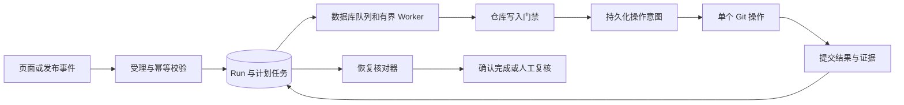

# 发布编排持久执行与中断恢复设计

状态：S1 已获批并于 2026-10-08 完成；S2–S5 尚未批准或实现。S1 实际边界见 `s1-implementation.md`。

## 1. 设计时事实基线与证据边界（2026-10-05）

| 事实 | 源码 / 证据 | 影响 |
|---|---|---|
| `startOrchestrate` 在事务方法内调用 Git，最后才 `runPort.save` | `RunAppService.java:86`、`:240` | 外部写入与数据库提交不原子，中途退出可能没有 Run |
| GitLab 合并一次调用包含创建 MR、等待、合并、部分失败关闭 MR等动作 | `GitLabGitBranchAdapter.java:75` | 单个“合并步骤”包含多个副作用，不能作为最小恢复单元 |
| 适配器把部分传输异常折叠为 FAILED，结果只有状态和字符串 | `GitBranchPort.MergeResult`、`GitLabGitBranchAdapter.java:150` | 无法区别确认未执行和响应丢失，缺少 MR IID / SHA 证据 |
| Run ID 是类型加毫秒时间，RunItem ID 没有 runId | `RunId.java`、`RunItemId.java` | 同毫秒可能碰撞；重跑会复用执行项主键 |
| 同范围第二次持久化后，旧 Run 的执行项变为 0，新 Run 为 1 | `RunRecoveryPersistenceEvidenceIT` | 已用真实 PostgreSQL 复现历史关联被转移 |
| `run_task` 表存在，未找到对应任务实体、调度器和 tasks 控制器 | V21、`RunController`、`frontend/src/api/runApi.ts` | 现有规范与前端接口设想不能当作已实现能力 |
| Run 状态在接口、持久化查询和前端按结果推导 | `RunController.RunView`、`runApi.ts` | 新增未知、恢复状态必须统一读模型 |
| 发布后监听依赖内存 AFTER_COMMIT 回调，异常仅记日志 | `WindowLifecycleListener` | 窗口已提交后宕机，自动编排意图可能丢失 |
| 关闭方法在外层事务中调用收尾并捕获异常 | `ReleaseWindowAppService.close` | try/catch 不能直接当作提交保证；S4 需验证内部事务失败与关闭状态的关系 |
| RunJpaEntity 的 version 没有 @Version，RunItem 无版本字段 | 持久化实体 | 不能把现有数字字段当作并发保护 |

设计阶段新增 4 项应用层故障注入和 2 项 PostgreSQL 证据测试。S1 已修复标识与历史关联问题，并将相关断言改为目标回归；其余中断恢复缺口仍存在。外部 Git 效果由测试对象模拟；不是实际 GitLab 写入或 kill -9 演练。上述测试是当前行为的证据，S1 起必须替换为目标不变量断言，不能永久固化错误行为。

## 2. 最终用户行为与不变量

用户触发后先得到可查询的 Run，页面明确“已受理”。进程中断后仍可看到计划、已确认步骤、结果未知步骤和下一处理动作。系统先核对外部证据，确认已完成的动作只补记结果；证据不足时保留仓库写入阻断，进入人工复核。

必须满足：

1. **先记意图，再发写请求**：没有提交的任务和 attempt，不得调用外部写 API。
2. **不可变计划**：封存仓库、迭代、分支、顺序、版本策略、文件路径和已读取 SHA；重试不能重新解释原计划。
3. **身份与幂等分离**：UUID 标识执行实例；幂等键标识同一次提交意图，不能用相同 ID 覆盖历史。
4. **结果未知不是失败**：请求可能到达外部系统但未获得完整响应时，进入 UNKNOWN，禁止直接重试。
5. **数据库租约不是 Git fencing**：租约代次只能拒绝旧 worker 的数据库更新，不能撤销已发出的 Git 请求。
6. **历史兼容不等于可恢复**：旧 Run 保留查询导出，不伪造任务意图、attempt 或自动重放。
7. **补偿是新操作**：不自动 revert 合并、删除已有分支/tag 或取消 pipeline；需要独立计划和明确授权。

不承诺通用 exactly-once。目标是持久受理、可核对的至少一次调度，以及未知结果下保守停止。

## 3. 架构与事务边界

- Domain：Run / RunTask / Attempt 状态、依赖、恢复决策与计划不变量；不依赖 Spring、JPA 或 GitLab。
- Application：`RunAdmissionService`、`RunCoordinator`、`RunJournalService`、`RunReconciliationService`；定义 Journal、Queue、RepositoryGuard、GitOperation Port。
- Infrastructure：PostgreSQL 持久化与 CAS、租约、有界线程池；GitLab 操作与证据适配器。先使用现有 PostgreSQL，不新增消息中间件。
- Interfaces：认证主体来自服务端上下文；校验幂等键、请求指纹和恢复动作，不信任请求体 operator。
- Frontend / Export：消费统一后端状态和证据；仅历史协议保留既有状态映射。

事务分段：

| 阶段 | 数据库事务 | Git I/O |
|---|---|---|
| 受理 | 保存 Run、局部范围快照、幂等键及触发意图 | 无写入；发布事务内也不做远程读取 |
| 计划准备 | 读取 Git 前置证据后，校验本地范围未变并封存计划和 DAG | 只读查询在事务外 |
| 领取 | 原子领取任务、增加代次、建立仓库保留与 attempt | 无 |
| 发出前 | 提交 SEND_STARTED，核验代次和前置证据 | 随后只发一个明确副作用 |
| 结果提交 | 同事务保存结果证据、任务状态和必要业务投影 | 无 |
| 恢复 | 先在事务外只读核对，再以代次 CAS 提交决策 | 默认只读；不在核对接口中执行补偿 |

协调器没有包围整轮流程的事务。短事务必须通过独立 Bean / Port 调用，不能依赖同类自调用的事务注解。外部成功但结果提交失败，已有 SEND_STARTED 会成为恢复依据。

发布场景在同一事务内提交窗口状态与持久受理意图，使用发布代次作为唯一触发键；AFTER_COMMIT 只做唤醒，遗漏唤醒由数据库轮询恢复。不能依赖现有普通 version 字段提供锁，必须新增真实 CAS / 乐观锁或显式行锁规则。

## 4. 数据模型与身份

仅新增或扩展结构，不改写历史证据；具体 Flyway 版本号在实施时取当时下一空号。

| 结构 | 关键字段与约束 |
|---|---|
| run 扩展 | UUID 新 ID、execution_version=2、显式 status、window_id、source、idempotency_key、request_hash、plan_hash、cancel_requested；旧 ID 保留 |
| run_item | 新执行项独立 UUID；唯一 `(run_id, repo_id, iteration_key, ordinal)`；业务范围键仅供展示和选择，不再作全局主键 |
| run_task 扩展 | 复用现有表；run_id 长度对齐 run.id，新增 item_id、action、ordinal、state_version、lease_owner、lease_until、generation、operation_key、前置条件和目标快照；保留旧行 |
| run_task_dependency | 前后任务边，禁止环；首版按仓库串行，跨仓并发待门禁验收后再开启 |
| run_task_attempt | 追加式 attempt UUID、次数、代次、INTENT_RECORDED / SEND_STARTED / 结果、时间、MR IID / 提交 SHA / tag / pipeline ID、脱敏错误与观察证据 |
| repo_execution_guard | 按规范化 provider/project 仓库标识唯一保留，持有者、代次及阻断原因；未决副作用保留独立于 worker 租约存活 |
| run_recovery_decision | 操作者、幂等键、原因、观察版本、证据摘要、决策、源 Run/Task/Attempt；不能只手工修改状态字符串 |

计划不保存 Token、请求头或完整敏感响应体。凭据使用时按仓库引用读取；仓库映射与分支目标在活跃计划期间受保护，凭据轮换不允许把原计划改指向其他远端。

逐步保存不能直接复用当前“整个 Run 转成实体后级联重写全部 items”的方式。Journal 对任务、attempt 和必要投影做有版本条件的定向更新；RunStep 可作为展示投影，append-only attempt 才是恢复证据。终态历史记录禁止被另一次 Run 更新。

幂等键唯一约束按调用主体/入口与 key 建立：相同 key 和相同 request_hash 返回原 Run；相同 key 不同 hash 返回 409。request_hash 对规范化业务输入计算，排除 operator 文本、时间戳和密钥。没有 key 的旧客户端由一次性请求产生新 key，不能因此声称具备跨请求去重。

计划受理还需拒绝空范围、失效引用和不满足既有分组/生命周期约束的输入，不能静默丢弃仓库后返回成功。集合规范化与执行顺序分开：计划固定顺序及确定的同序号消歧规则。预览可有多个，但同一窗口/动作类型只能有一个活跃执行；跨窗口共享仓库再由仓库门禁串行化。

## 5. 状态与恢复决策

Run：PLANNED → PENDING → RUNNING → COMPLETED / FAILED；中断进入 RECOVERING，再进入 RUNNING / NEEDS_REVIEW / 终态。取消仅停止未发出的任务；已发出的请求必须核对，页面显示已有副作用。

Task：PENDING → RUNNING → COMPLETED / FAILED / UNKNOWN。UNKNOWN 经核对进入 COMPLETED、PENDING（已证明未发出或未生效）或 NEEDS_REVIEW；不能直接交给普通 retry。SKIPPED / CANCELLED 只适用于未执行或被规则跳过的任务。

已确认未生效且被计划策略允许的自动重试，可以在预算内回到 PENDING 并追加 attempt；确认不可重试或预算耗尽才终结为 FAILED。该预算与读取核对的重试预算分别记录，不能由 adapter 隐式决定。

确认 FAILED 的终态 Run 保持不可变：retry 创建带来源链接的新 Run/Item/Task 和 attempt，只选择确认失败项；原成功步骤通过证据引用继承，不重新执行。resume 仅继续尚未终结的 RECOVERING/NEEDS_REVIEW Run，经核对后的任务才可进入下一步。这样保留现有“retry 返回新 Run ID”的用户路径，同时避免把历史终态改回运行中。

聚合状态由后端统一判定：任何未决副作用优先显示 RECOVERING/NEEDS_REVIEW，不能仅凭部分成功或 finishedAt 显示完成。failFast=true 时确认失败停止后续派发；未知结果始终阻断同仓写入，其他仓库是否继续按计划的 failFast 策略处理，并明确记录未执行原因。

| 中断位置 / 证据 | 决策 |
|---|---|
| 受理事务未提交 | 无任务可派发；同一 key 重交可创建计划 |
| 计划已提交，尚无 SEND_STARTED | 按协议证明未发出，允许重新领取 |
| SEND_STARTED 已提交，无完整响应 | UNKNOWN，保留仓库阻断，先核对 |
| 明确外部完成，结果未落库 | 核对精确操作标识及计划 SHA 后，只补记完成，不再次写入 |
| 查询暂时不可达 / 403 / 列表分页未完整 | UNKNOWN / NEEDS_REVIEW，不能判定不存在 |
| 查询未找到目标，但原请求仍可能在途 | 仍是 UNKNOWN；一次“查不到”不构成安全重放依据 |
| 外部状态与计划 SHA、所有权或版本不一致 | NEEDS_REVIEW，不把其他人的操作算作本 Run 成功 |
| 旧 worker 在代次变更后返回 | CAS 拒绝结果覆盖；禁止其再发后续写请求 |

读取失败可以有限退避重试；写请求只有已证明未发出、明确未生效且满足前置条件，才按策略允许新 attempt。退避、最大次数和截止时间必须入计划，不能藏在 HTTP 适配器内无界重试。

## 6. 各类外部操作的核对策略

| 操作 | 必须保存的事实 | 核对与限制 |
|---|---|---|
| 创建分支 | 操作标识、分支名、精确起点 SHA、目标原先是否存在 | 分支指向符合计划的 SHA 只能证明目标状态满足；归属无法确认时标为“已满足”，不得自动删除 |
| 创建 MR | 操作标识写入受控描述、源/目标、源 SHA；返回后立即保存 IID | 精确关联匹配并完整分页核对；零匹配且仍可能在途时不能重建，多匹配进人工复核 |
| 合并 MR | 已持久化 IID、源 SHA、目标前态、merge/squash 策略和操作标识 | 读取该 IID 的状态和合并证据；不能只看两个分支当前相同就认定是本操作完成 |
| 版本文件更新 | 每个文件的前态哈希、目标内容哈希、已知提交 ID、提交关联标识 | 首版按文件建立步骤；部分成功阻断后续发布，不能宣称多文件原子。当前内容已是目标时补记，其他漂移需复核 |
| 创建 tag | tag 名、目标提交 SHA、原先存在性 | 同名同 SHA 可满足目标；同名不同 SHA 阻断，禁止覆盖 |
| 归档分支 | 拆成创建归档引用与删除源引用两项；保存期望 SHA 和归属 | 删除前核对源未变化且归档已确认；有外部并发、缺少原子条件时不自动执行删除或补偿 |
| 触发 pipeline | 操作关联变量、ref/SHA，收到后立即保存 pipeline ID | 不能依赖未知的通用幂等承诺；结果未知且不能找到唯一关联证据时人工复核，不直接再触发 |
| 迭代归档等 DB 动作 | 期望状态/版本与 task key | 用单库事务和唯一约束做到幂等，与步骤完成投影一起提交 |

现有 `mergeBranch` 必须在新协议中拆成创建 MR、读取状态、合并等窄操作；现有内部 405 重试和自动关闭 MR 也须转成显式策略和任务。GitHub 与 GitLab 能力不对称，未实现核对能力的 Provider 必须报告“不支持自动恢复”，不能伪装安全。

官方资料核对：GitLab 合并 API 的 `sha` 校验针对源分支 HEAD，不能据此假设目标分支 CAS 或通用 fencing；文件更新支持 `last_commit_id` 前置字段；pipeline 创建支持关联变量和返回 ID。本方案仍按“不依赖通用写请求幂等保证”设计。参见 [MR API](https://docs.gitlab.com/api/merge_requests/#merge-a-merge-request)、[文件 API](https://docs.gitlab.com/api/repository_files/)、[Pipeline API](https://docs.gitlab.com/api/pipelines/#create-a-new-pipeline)。当前文档包含新版本特性，17.11 归档页面本轮未读取成功；S2 必须在仓库使用的 GitLab 17.11.3 fixture 上确认能力，不直接套用 19.x 行为。

## 7. 并发、租约和旧入口

工作领取使用短事务、`FOR UPDATE SKIP LOCKED` 或等价 CAS。调度周期、超时、心跳和并发度可配置；首版 worker 并发为 1，但数据协议从第一版支持代次检查。数据库时钟决定租约，避免节点时间差。

仓库保留与 worker 租约分离：worker 消失不等于外部请求结束。租约过期只允许新 worker 接管核对，不自动取得继续写入权。每个外部写入之前重新核验代次；同一仓库最多一个在途写操作。

必须覆盖的内部写入口包括 Run 编排/重试/版本更新/收尾、`AttachAppService`、`IterationAppService`、`CodeMergeService`、`ReleaseBranchService` 以及其 Git 分支和文件 Port。旧入口必须原子登记写入保留，而不只是先查一个布尔值；否则查询到派发间有竞争窗口。无法纳入门禁的入口，在新协议启用范围内显式拒绝执行。

系统无法阻止 GitLab 上的人工或其他 CI 写入。源/目标漂移必须进入复核；不声称内部租约可以阻止外部写入。未知旧请求未明确终结前，不能因超时就释放仓库保留给另一个 Run。

## 8. API、页面和兼容策略

| 入口 | 目标行为 |
|---|---|
| 新增 `POST /release-windows/{id}/run-plans` | S1 创建只读执行计划预览并返回可查询 Run，绝不派发 Git 写入 |
| `POST /release-windows/{id}/orchestrate` | 新协议受理返回 202 与现有 `ApiResponse<String>` Run ID；增加 Idempotency-Key；这是需联动客户端的行为变更 |
| `GET /runs/{id}`、paged、export | 统一 executionVersion/status、进度、阻断原因、窗口与计划关联；旧记录按 legacy 口径展示 |
| `GET /runs/{id}/tasks`、`.../tasks/{taskId}/attempts` | 补齐真实后端能力，返回任务与尝试证据，不返回凭据 |
| `POST /runs/{id}/reconcile` | 只读外部核对并记录决策，不写 Git；请求需幂等 |
| `POST /runs/{id}/resume` | 仅对满足恢复前置条件的任务继续；UNKNOWN 不允许 force 绕过 |
| 现有 retry | 新协议只选择确认失败且可重放的任务；未知结果返回明确阻断；历史 Run 不自动转成新协议 |

新协议 retry 请求使用 `taskIds`、reason 和 Idempotency-Key，返回新 Run ID；不信任 operator 请求字段。旧 `items` 复合范围键在接管后若不能唯一映射任务，必须明确拒绝，不能默默选择同范围的全部步骤。

UI 在受理后轮询 Run/Task，达到终态、离开页面或取消观察时停止；不再把 HTTP 返回等同于完成。新增“结果未知”“待复核”“仅恢复查询”“继续执行”的区别，解释已有副作用和人工动作依据。导出与页面使用同一后端判定，不在前端另算成功状态。

旧协议的查询和导出保留；缺少任务/attempt 的历史 Run 不支持自动恢复。旧失败项重试在接管的动作类型上改为受控复核后创建新计划，保留原记录和来源链接；该变化在切换前明确告知。版本更新与收尾在 S4 完成前不宣称已经获得相同恢复保障。

关闭窗口与收尾是两个状态维度。未来关闭事务保存业务 CLOSED 与持久收尾意图；收尾失败不能伪装为全部成功，也不能自动把窗口改回 PUBLISHED。

此处明确选择与当前已验收页面一致的“关闭触发收尾”，修订旧规范中“关闭前独立收尾”的描述；该产品语义与异步返回一起进入提案评审，不隐式改变用户流程。

## 9. 实施顺序与非目标

| 切片 | 用户可见结果 | 依赖 | 放行条件 |
|---|---|---|---|
| S0（本轮） | 可评审设计与已复现缺口 | 无 | 证据、风险和方案完整；不部署恢复逻辑 |
| S1 | 唯一 ID、历史执行项隔离、可查询的持久计划预览 | 批准本提案 | 同毫秒并发不碰撞；旧 Run 不丢项；计划预览零 Git 写入 |
| S2 | 计划中的操作可得到明确、可解释的核对结果 | S1 | 窄 Git 操作和全入口门禁，17.11.3 能力验证，未知结果不重放 |
| S3 | WINDOW_ORCHESTRATION 异步受理、逐步落库、重启核对和页面展示 | S2 | 发布意图事务闭环、进程故障和双 worker 测试通过，再受控启用 |
| S4 | 版本更新与收尾纳入同一恢复协议 | S3 | 多文件、tag、归档、pipeline 与取消的风险矩阵全部验收 |
| S5 | 受控试用和运维交付 | S4 | 硬中断、数据库故障、租约与回滚演练及 UI 旅程通过 |

不引入 RBAC、消息通知、新 Git Provider 或分布式中间件；不自动修复已损坏的历史关联，不批量重写旧 Run，不自动补偿不可逆 Git 结果。所有未完成项保留在 tasks.md。

## 10. 验收与故障矩阵

至少覆盖：重复 key、key 与请求冲突、同毫秒并发、同范围多 Run、进程在每个事务边界前后退出、远端成功后响应丢失、结果提交失败、发布提交后回调未执行、worker 租约过期后恢复、双 worker 抢占、人工修改源/目标 SHA、分页或权限导致证据不完整、版本文件部分成功、pipeline 结果未知、取消时已有在途操作、旧记录只读兼容。

S3/S5 使用独立应用进程和外部 fixture，在持久检查点间实施真实进程终止与重启；检查 Git 实物、Run/Task/Attempt、UI 和审计的一致性。本轮 6 个缺口证据不能替代这些恢复验收。

## 11. 迁移、部署和回滚

先扩展结构，不删除旧列或旧表。保留原 Run/Item ID，不自动重建历史关联；新增 execution_version 区分协议。发现旧 run_task 或跨 Run 关联异常，先只读盘点、备份和人工审计，不能猜测历史归属。

默认关闭新执行器；S1 仅计划预览。启用 S3 前先完成旧入口门禁，排空旧写请求并确认没有未知旧操作；禁止两套执行器同时写同一仓库。分阶段开放已验收的动作类型。

回退时先停止受理和派发，等待或核对在途操作；NEEDS_REVIEW/UNKNOWN 的仓库保留不得自动删除。新协议运行存在时不能把旧版本直接恢复为写服务；旧 UI 可只读回退，恢复执行使用兼容新表的版本。数据库恢复后先隔离写流量并核对外部 Git，不能按备份里的 PENDING 状态直接重放。

## 12. 评审决策

建议首先只批准 S1：修复 ID/历史隔离，并提供持久计划预览；不启用 worker、不写 Git、不迁移历史记录。S2 以后须以对应切片验收和 Provider 能力证据作为放行条件。本轮不代替用户作出批准结论。
