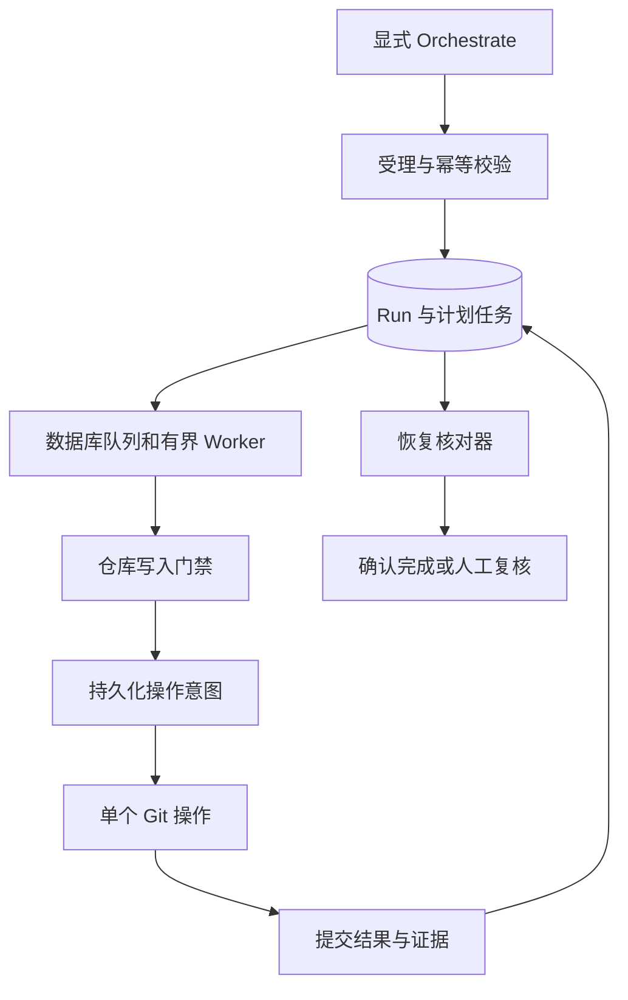

# 发布编排持久执行与中断恢复设计

状态：S1、S2 已于 2026-10-08 完成；2026-11-21 用户授权继续研发和分阶段推送，S3-A/B1、S3-B2、S3-C1、S3-C2-A、S3-C2-B1 已验收并推送。C1 固定 `e5094ba` 的 Full-Link 44899945002、C2-A 固定 `1761572` 的 Full-Link 44905843754 均为 5/5。C2-B1 代码 `3f810c8`、文档 `5441df6` 已推送，固定 `5441df6` 的 Full-Link 44911634004 为 5/5。C2-B2 已分组推送，固定 `cc800362f333418776f4a816e1fa74ee9f08c04f` 的 [Full-Link 44917254215](https://github.com/tongsh6/release-hub/actions/runs/44917254215) 为 5/5；规范化建分支成功证明与 APPLIED 结果投影恢复已交付。C2-B3 后端 d87dfa8、文档 544983b 已推送，固定 `544983beff74604852c050209e4c8caa93678ef2` 的 [Full-Link 44924378741](https://github.com/tongsh6/release-hub/actions/runs/44924378741) 为 5/5，B3 已 DONE；本地最终 403/48/738、静态与历史轮次证据见记录 16.2–16.6。C2-B4、B5 已完成本地与各自固定 SHA CI 验收并推送，证据见记录 17.5、18.9。C2-B6 原 MERGE 未发送意图的本地收口已完成：相关单次 749/API 48/普通 816、前端 217 与静态通过，实现 4e992e9、文档 29ec005 已推送，固定实现 SHA 的 Full-Link 44940092094 为 5/5（记录 19.9）。B7 已完成独立 RED、定向 91/91、单次相关 840/840、API 48/48、普通 831（826 PASS / 5 既有 SKIP）、静态及源码绑定，实现 00def779 已推送；固定实现 SHA 的 Full-Link 44945748427 attempt 2 为 5/5，B7 已 DONE。首轮 Central 429 与最终结果见记录 20.8–20.9，验收文档单独收口。B8 已完成独立 RED、定向 125/125、单次相关 965/965、API 48/48、普通 877（872 PASS / 5 既有 SKIP）与静态验收；实现 `537588e782c2b3bb2d2e82e21804f2d37fb42fc2` 已推送，固定该 SHA 的 [Full-Link 44972473174](https://github.com/tongsh6/release-hub/actions/runs/44972473174) attempt 1 为 5 PASS / 0 FAIL，B8 已 DONE。详见任务记录 21.6–21.11。B9 原 CREATE_MR INTENT 的安全接续与本地收口已 DONE：相关1078/1078、API48/48、普通918（913 PASS / 5既有SKIP）、静态与最终源码审计通过，实现 `666acdc7a60c0922db2f05713cbfefd23eed8265` 已推送，固定该SHA的Full-Link 44978661003 attempt 1为5 PASS / 0 FAIL。证据与边界见记录22.7–22.14，验收文档单独收口。B10「MERGE_MR 精确只读核对证据」已DONE：相关1123/API48/普通942、前端218与静态及源码审计通过，实现 `8dcca5bf8265a3a1f36c16a14f0e3b8b0b35652d` 已推送，固定该SHA的Full-Link44982102777 attempt 1为5 PASS/0 FAIL，证据见记录23.7–23.11。当前唯一 HEAD 为 C2-B11「GitLab MR读取响应状态证明」；后续SEND/UNKNOWN窄恢复继续QUEUED，再按原顺序推进SA-002。

## 0. 当前研发蓝图与授权（2026-11-21）

用户已明确授权持续研发、必要重构、分组提交和分阶段推送。项目尚未上线，本轮不保留旧写入口、兼容层或双轨执行；此前 S3–S5“尚未批准”的记录仅是历史状态。实现与验收仍逐切片记录，授权不等于能力已经完成。接手基线为 `5d85b17` 加工作区 S2 改动，119 项针对性测试和 26 项前端组件测试仅用于定位；现已将 `main`、`develop` 收敛到 `d4534cc`，开发位于 `feature/orchestration-consistency`。当前验收与提交证据见本轮任务记录，不以既有测试决定业务正确性。

### 端到端目标

1. Attach/Detach 仅维护窗口与迭代关系；完整校验后原子写入，重复挂载不改变 attachAt。发布仅改变业务状态，默认 MANUAL 不隐式写 Git。
2. 页面从现有 plan 获取权威仓库并集与三元组，不从详情请求成功的子集缩小执行范围。用户选仓库与迭代、确认阻塞策略后，仅由 Orchestrate 执行 feature → release；关闭窗口才进入既有收尾流程。
3. 编排先完整校验范围，按 attachAt 和稳定次序确定队列。复用现有 Run/Item/Step、计划快照及 Git 操作账本，先落可查询计划与执行意图，再执行逐项记录。不同仓库互不传播普通失败；同仓串行。
4. 默认 FAIL_FAST：阻塞后该仓库剩余项显式 SKIPPED_DUE_TO_BLOCK、executedOrder 为 0；其他仓库继续。CONTINUE_ON_BLOCK 仅用户显式选择。UNKNOWN 始终停止该仓库后续写入，不能普通重试。
5. GitLab 集成始终 MR-first，已有 opened MR 可复用，已确认 merged 不重复制造副作用；真实 MR IID/URL、项目、分支、窗口、迭代、原因与请求证据进入现有 Item/Step/操作账本。
6. Run 状态由领域统一汇总：全仓完成 DONE；部分仓失败 PARTIAL_FAILED；全部仓失败或无有效范围 FAILED。前端、列表、详情、导出和版本操作消费同一状态；时间戳不构成成功证据。
7. 文件更新携带业务读取时的原 revision；读取 A 后远端变为 B，A 派生内容不得覆盖 B。复用 GitLabFilePort 和原有文件更新器，不另造同义接口。
8. 收尾失败必须真实呈现；tag 失败不得继续宣称成功或归档。跨窗口共享分支不得由单个 Detach/Close 自动删除。重试按原动作和原计划执行，不把收尾误当作 feature → release。
9. 可恢复异步执行在以上语义统一后接入已有持久计划与操作账本，完成短事务、领取、逐步结果和未知核对；未通过独立进程中断及重启验收前，页面不得宣称可恢复或提供空壳 resume。

### 职责查重与反例

| 已有承载者 | 本轮职责 | 必须推翻旧行为的反例 |
|---|---|---|
| WindowIterationPort / AttachAppService | 纯绑定、去重与稳定 attachAt | 混组批次校验失败零写；重复挂载不重排；解除共享仓库零 Git |
| 现有 plan / RunAppService / RunItem | 唯一集成入口、完整范围、计划与实际顺序 | I1 阻塞导致同仓 I2 被记录跳过，但 R2 仍执行；不存在仓库不能静默省略 |
| Run / RunExecutionStatus | 唯一状态事实 | MERGED 应完成；有 FAILED 步骤不能被后续 SUCCESS 掩盖；空执行不成功 |
| GitMergeWorkflow / GitMergeRequestPort / 操作账本 | 窄 MR 动作、重用和证据 | 同 source/target 重试不再造 MR；未知结果不重放 |
| GitLabFilePort / 文件适配器 | 内容与读取版本同源 | A→B→A′ 必须拒绝，缺读取 revision 零写 |
| 现有前端 API/组件与无状态展示工具 | 权威 scope、精确状态、入口收敛 | 详情 503 不缩小请求；共享 repo 只计一次；集成按钮不描述收尾 |

新增记录或辅助对象必须有上述实际消费者；不预建完整任务平台。接手时 `run_task` 只有表结构、没有执行消费者；C1 由既有 RunAppService 消费固定任务协议，表结构与实际执行证据分别核对。无人调用的 ReleaseBranchService 及其自测已删除，不保留第二条窗口写路径。

真实 E2E 前置复核又发现 IterationAppService 的 create/update/addRepos 直接建分支，以及 update/removeRepos 直接归档的旧入口。它们会在配置事务内写 Git，且创建失败曾被日志吞掉。C1 同批移除这些副作用，保留已有分支命名、模式和版本映射职责；AUTO/NAMED 只配置，EXISTING 保留必要只读存在验证。移除仓库只调整关联与关联版本配置，远端分支和历史 Run 证据保留。建 feature 统一由已有 ENSURE_FEATURE 消费，不建立另一种迭代执行器；具体正反例见本 change 的 iteration delta。

### S3-B2：仓库级关闭受理与收尾执行

本切片复用 RunPlanAppService、SavedRunPlan、Run/Item、GitBranchPort 与操作账本，不新增收尾实体、Port 或任务平台。收尾 Item 的 iterationKey 为 null；participatingIterationKeys 保存真实参与者。V38 仅放宽该字段的非空约束，普通集成仍保持三元组身份。

关闭短事务对窗口行加 PESSIMISTIC_WRITE 锁，完整校验引用、仓库映射、默认/release 分支及版本后，一起保存 CLOSED、WINDOW_CLEANUP Run 和不可变计划。Attach/Detach、Publish、Freeze/Unfreeze、Delete 与普通 Orchestrate/retry 受理使用同一窗口锁，避免旧状态覆盖关闭或关闭后再受理写入。首次 cleanup 在锁内拒绝该窗口已有 RUNNING/NEEDS_REVIEW 的执行意图；PLANNED 预览不阻断。这样已受理编排不会在旧 release 完成收尾后继续写入。相同窗口重复 close 核对原完整计划并返回同一 Run；操作者仍为首次受理者，改变 triggerCi 返回冲突。CLOSED 缺计划不得凭当前配置重建执行。只有首次受理者执行远端动作，事务已在首个 Git 调用前提交。

一个仓库只执行 MERGE_TO_MASTER → CREATE_TAG → TRIGGER_CI。各仓独立，仓内步骤失败或 UNKNOWN 停止后继，检查点持久化失败直接中断派发。release 缺失不回退 main；同仓参与迭代的不同目标版本整批拒绝，缺任一明确版本不猜 Tag。Tag 指向已确认 MR 的 mergeSha，不采用移动的 main tip；同名同 SHA 只读复用，同名异 SHA 失败，确认拒绝后仅允许读取并发创建的精确 Tag，不重发 POST。若 ALREADY_MERGED 只有包含关系而没有 mergeSha，计划中的 Tag 明确失败。

POST close 可选请求体 {triggerCi:boolean}，省略为 false；显式 true 必须有稳定 Tag，ciRef 封存为同一 Tag。返回实际 RunView，界面刷新 CLOSED 并展示 Run，不以 HTTP 200 宣称收尾成功。Pipeline APPLIED 必须匹配 project/id/ref/SHA/url；4xx 明确拒绝，408、5xx、传输异常和不完整或不匹配 2xx 为 UNKNOWN。CI_TRIGGERED 只说明触发成功，未选择 CI 记录 SKIPPED。

Tag/CI 使用确认的 numeric project ID，命名空间变化在派发前阻断；内部门禁 header 不外发。写响应与只读核对复用严格身份/SHA 判定。只读核对缺 pipeline ID 或 expected SHA 不猜列表结果；错误 Tag 名、同 ref 异 SHA 不能认定 FOUND。未知结果保留 guard，普通 retry 不接受收尾。feature/release 与全局 Iteration 均保留，metadata cleanup.referencePolicy=RETAIN 表达真实策略；没有 ARCHIVE_BRANCH 或 DELETE 副作用。

该受理和检查点模型尚不提供后台 worker 或自动 resume；受理后进程退出，重复 close 只返回原记录，不恢复执行。恢复能力继续在 S3-C/S4 验收。

### S3-C1/C2：同一任务协议分步接入

C1 将请求线程接入唯一 WINDOW_ORCHESTRATION 持久任务路径，固定 ENSURE_FEATURE / ENSURE_RELEASE / ENSURE_MR / TRY_MERGE。复用 V21 的 run_task、既有 RunPort/RunPlanPort、Run/Item/Step 和操作账本；不新增 DAG、依赖表或尝试账本。原始 request key 与带动作域的请求指纹共同限定受理；同主体同 key 同请求先返回原 receipt，再考虑当前窗口是否变化，异动作或 payload 返回冲突。Run、Item、计划和任务同事务提交；旧 Run 只供查询，不猜测补造任务。

C1 采用一次领取凭据，PENDING → RUNNING 后由 taskId/claimToken/status 约束 journal begin、SEND_STARTED 和结果提交。没有重领入口，不预建无人消费的租约、心跳或 generation 平台。Task 结果、唯一 Step、所属 Item、Run 汇总、绑定投影及 guard 确认必须同一短事务；远端事实先独立记录，但 adapter 返回不等于业务提交。禁止新任务协议回到整份 Run 级联保存。不同仓库的短事务投影必须保留彼此进度，同仓任务仍按稳定顺序执行。

ENSURE_MR 持久保存项目 ID、IID/URL、source/target、冻结 source SHA 与 disposition；TRY_MERGE 只从该检查点继续，并固定预期项目身份。MR 创建成功后结果提交失败、Git 合并成功后投影失败、进程在两阶段之间退出，都不得重新创建 MR 或派发后继写入。SEND_STARTED 后即使旧线程暂停、超时或只读查询暂时 404，仍不能证明可以再发一次。

项目身份从第一次已确认分支读取开始固定，包含 ALREADY_EXISTS 和确认 404，不等到第一次 POST 才确认。GitBranchPort.BranchStatus 携带项目 ID，Context 在单任务内拒绝重新绑定；同 Run 同仓库的后续 Item 和重试从已有 metadata 继承唯一身份，原 MR 身份及冻结 SHA 不被部分响应清除。Run.repositoryProjectId 承担聚合内唯一事实规则，由受理与存储投影共同消费。

成功重试前缀使用 INHERITED 状态和原 Run/Item 来源，不复制成功 Step 或伪造新的 CREATED/MERGED。FAIL_FAST 只跳过同仓后继；UNKNOWN 始终停止该仓，Run 进入 NEEDS_REVIEW 后其他仓库仍可领取和提交。任务结果、Step、Item/Run 投影与 guard 确认同一事务，旧 claimToken 和整份 Run 保存均不能覆盖新事实。

C1 的独立验收是重复请求返回原回执，已确认步骤具有持久事实，中断后可查询且安全停住；它不声称自动恢复。C2 使用同一个执行器增加有界 worker、202/前端轮询、数据库扫描、租约和证据驱动的核对/继续；AFTER_COMMIT 仅作唤醒提示。完整硬中断、重启继续、双 worker 与丢失唤醒在 C2 验收。两阶段都不提供 force 绕过未知事实，收尾恢复仍属于 S4。

#### C2-A 的纵向切片与反例

C2-A 删除请求线程的窗口任务驱动；Orchestrate/retry 仍复用 RunPlanAppService 受理，在事务提交后返回 202 与同一 Run ID。RunAppService 收窄为一次领取和执行一个 Task，RunPort/JPA 提供有界候选发现。扫描限定当前 WINDOW 协议、RUNNING/NEEDS_REVIEW 且有 PENDING；使用游标轮转避免不可领取的最早一页饿死后续 Run，最终资格只由既有 claimNextTask/eligible 决定。没有额外消息队列或运行时 DAG，数据库扫描是可靠来源，AFTER_COMMIT 并非必要依赖。

新增基础设施 worker 具有实际消费者：在有界线程池中调用上述唯一单任务执行方法。领取发生于 worker 开始后，提交拒绝/排队取消不会制造已领取孤儿；不使用 caller-runs 回退。不能按整个 Run single-flight，否则 R1 的阻塞 HTTP 会连带阻止 R2；短事务继续使用 Run→Task→guard 锁序，同仓前序 RUNNING/UNKNOWN 仍阻断后继。C2-A 不重领 RUNNING，领取后强杀保留原事实。

UI 复用 executionIntent 的原 actor/operation/key/payload，并在原页面提供不依赖当前 scope 的回执找回；已确认 receipt 后仅查询原 Run。轮询与路由初始化分开，不每次清空详情或选择；Run=NEEDS_REVIEW 时若其他仓任务仍活动则继续观察，离页、换主体或有界观察停止后不再排请求。API、OpenAPI、组件、真实 E2E 和 shell 消费者必须一起迁移，不能把 202 当作执行成功。

独立出口：受理响应不等待被 latch 阻塞的 Git；无内存唤醒仍能推进；拒绝投递零领取；阻塞前页不饥饿；双 worker 同仓串行/跨仓进展；旧协议/其他动作零误派发；冻结后原回执可找回而新意图仍校验；独立 JVM 在 ENSURE_MR 检查点后重启只消费原 PENDING TRY_MERGE，MR POST 不增加。该切片通过后也不能宣称任意中断点自动恢复。

#### C2-B 的接管约束

当前操作账本对 task_id 唯一，观察、迟到结果和 ack 还关联原 claimToken；不得通过换 token 再创建第二个 operation 来规避。C2-B 需沿现有账本区分历史 HTTP 事实、当前发送权和当前投影权；只读 FOUND 还须验证动作所需的项目、IID、分支与冻结 SHA。无 SEND 的意图、已确认 HTTP 结果和 SEND_STARTED 后未知请求分别处理。租约过期或单次 404 均不能授权重发，未知事实不得仅凭 FOUND 解除 guard。

##### C2-B1：无写意图的过期领取（已验收，提交推送完成）

用户价值是进程已领取任务、尚未建立写意图时，后台能继续原任务；先独立验收这一边界，再处理已有 operation。只沿既有 RunPort/JPA、RunTask、RunAppService.executeNextTask 和 RunTaskWorker 扩展，不新增恢复实体、执行器、API 或按钮。

资格必须同时满足：当前 WINDOW 协议、Run=RUNNING/NEEDS_REVIEW、Task=RUNNING、原 token/首次 started_at/到期值非空、已有正的 Item.executedOrder、期限已到，且该 task_id 没有任何 git_operation 和任何 run_step。缺少领取事实时保持原状，不替已领取任务补造实际顺序。operation 按 task_id 跨所有状态/所有 token 排除，包括 INTENT；Step 只查当前 task，不因同 Item 的成功前缀而阻断最后一步。

扫描方法直接改为 findTaskCandidateRunIds，继续有界游标和提交后领取；发现 PENDING 或无 operation/Step 的过期 RUNNING 候选，扫描不承诺执行资格，缺失实际顺序的候选仍在锁内拒绝。最终资格仍在 Run→Task 同一事务锁内重新检查，换 token 的条件更新再次带原 token、状态、期限及双 NOT EXISTS，并要求恰一行。旧 begin 先提交则接管拒绝；接管先提交则旧 begin/complete 均被 token 拒绝。到期只是候选条件，不给 sending/finish/ack 添加期限拒绝，不自动清 guard。

| 现有时间责任 | C2-B1 实际实现 |
|---|---|
| Task.started_at | 保留首次领取事实，继续供 TaskView/页面展示，接管不覆盖 |
| TaskClaim.startedAt | 每次从当前 worker Clock 取本次执行起点；Step 起止同源，不强制等于首次 Task 时间 |
| 新 claim_expires_at | 唯一新增字段；扫描和领取实际消费，使用取得锁后的数据库 clock_timestamp 加期限，接管重新设值 |

PostgreSQL CURRENT_TIMESTAMP 固定为事务开始时刻，不能在长锁等待后用于新期限；依据 [PostgreSQL 18 时间函数](https://www.postgresql.org/docs/18/functions-datetime.html#FUNCTIONS-DATETIME-CURRENT)。数据库前跳只会提前产生候选，后跳会推迟恢复，均不能绕开 token 与无写意图证明。NULL 期限不推断到期，不由旧 started_at 回填执行资格。新列同时进入 V40 Flyway 与既有 JPA 映射；local 实际使用 Hibernate update，没有第二套手工初始化器。

配置直接注入既有持久适配器，releasehub.run.worker.claim-lease-ms 默认 3600000，正数才有效，不透传穿过 AppService/Port。无心跳第一片取保守 60 分钟：当前 TRY_MERGE 最多 20 页 contains、1 次 MR、80 次 readiness 及身份检查，按现有 connect/read 配置计算约 34 分 30 秒预写预算；这不是严格网络上界。过短配置可能使健康长读反复失去结果提交权，不能靠延长页面观察或 E2E 启动等待掩盖。隔离测试可用短期限；正常执行没有新增等待。

| 独立正反例 | 必须观察到的结果 |
|---|---|
| 仅最后 TRY_MERGE 已领取，前三步完成，无 PENDING | 到期后扫描发现原 Run；保留原 project/IID/SHA、任务和实际顺序 |
| 两个 worker 竞争同一过期任务 | 仅一个新 token；另一方不能接管刚刷新期限的 claim |
| 旧 GET 在新接管后返回，或准备写入 | 旧 complete 与旧 begin 都拒绝；旧请求零写、结果 Step 不重复 |
| 旧 begin 先提交，或已有任意 operation/当前 task Step | 接管不改变 token、事实或 guard；其他仓库仍按原规则推进 |
| Run 锁等待超过隔离期限、两个 worker Clock 偏移 | 新期限仍基于拿锁后的 DB 当前时间；Task 首次时间保留，Step 起止来自本次 worker |
| MR 检查点已提交，TRY 已领取但无 operation，强杀并重启 | 默认 worker 接管原 TRY；MR POST 仍 1，MERGE PUT 恰 1，成功前缀逐字段不变 |

回滚先停止派发，保留任务、期限和证据；不恢复同步旧循环、不将 RUNNING 改回 PENDING。已有 INTENT 的发送权转移、APPLIED 只补投影、SEND_STARTED/UNKNOWN 精确核对与 guard 确认属于 C2-B 后续子片，不以本片完成宣称完整恢复。

##### C2-B2：规范化建分支证明与投影恢复（已交付）

C2-B1 固定 `5441df6` 的前置验收与 C2-B2 本地门禁均已完成；B2 三组提交已推送，固定 `cc800362f333418776f4a816e1fa74ee9f08c04f` 的 [Full-Link 44917254215](https://github.com/tongsh6/release-hub/actions/runs/44917254215) 为 5/5。正常创建成功证明的规范化与 CREATE_BRANCH/APPLIED 投影恢复在同一切片交付。用户价值是 CREATE_BRANCH 的 HTTP 结果已持久化、原 ENSURE_FEATURE/ENSURE_RELEASE 结果尚未提交时，后台只补原 Task 投影。恢复阶段不访问网络，不新增实体、API、UI、发送入口或通用恢复平台；MR、INTENT 发送权、SEND_STARTED/UNKNOWN 与其他执行类型仍分别排队。

APPLIED 不是业务完整证明。[GitLab 创建分支契约](https://docs.gitlab.com/api/branches/#create-repository-branch)规定成功响应为 201 Created，正文包含分支 name 与 commit.id，ref 可为分支名或提交 SHA。本片仅接受 201 加完整匹配的 name/commit.id；202 Accepted 等其他 2xx 即便正文看似成功也属于未确认。正常创建与既有 HTTP event 的 evidence_json 证明必须共用该创建成功判定，规范化只允许确切 commit.id，commit.sha、object.id/object.sha 或其他字段均不得替代或覆盖；不改变 GET 分支、Tag 或其他动作契约。

初始 RED 基线的 createBranch 只检查 2xx、name 和 commit.id 格式，拦截器循环又覆盖 commitSha，真实 HTTP 已复现错误 commit.id=B 被 object.id 或 commit.sha=冻结 A 掩盖后错误 APPLIED/CREATED 并确认 guard。现正常客户端、拦截器和恢复投影共用 createdBranchSha，201 的规范字段和冻结 SHA 匹配才确认；完整正反例已通过本地组合验证。201 只有 object.id、非 201 正文完整仍保持拒绝。无完整证明的旧摘要不推断成功、不补造字段，也不以额外 GET 或通用 FOUND 绕过；现拦截器判为 UNKNOWN 时会关闭响应并抛 IOException，不能假设原正文仍返回正常消费者。

计划与 HTTP 意图分别承责：plan.defaultBranch 保留计划的原 ref 表达，现两个 ENSURE 分支动作都将它传给 createBranch；拦截器先保存 target.sourceRef，再解析并把 target.ref 固定为实际提交 SHA。投影须同时验证 sourceRef 等于已存 plan.defaultBranch、target.branch 等于对应计划分支、target.ref 是合法 SHA，双方都通过 40/64 位十六进制校验后，以忽略大小写的值比较规范化响应 commit.id；branch/sourceRef 保持精确匹配。不得把命名 ref（如 main）直接当作 SHA 比较，不重新解析当前 ref。远端身份取原 operation 的 numeric project，与同 Run/仓库已有持久 git.projectId 一致；缺少 Item 身份时只从该已持久 operation 补入，不能因当前 namespace 改向而更换项目。

| 既有职责 | 本片的实际消费者与边界 |
|---|---|
| GitWriteHttpInterceptor / 正常分支响应校验 / 原 event | 统一成功证明，由正常返回与恢复投影共同消费；不保存 Token 或完整敏感响应 |
| GitOperationJournalPort / 原 operation 与 guard | 在结果事务内核实唯一 task operation、完整证明及相同 session/generation/operation 归属 |
| RunPort / RunJpaPersistenceAdapter / completeTask | 同 Run→Task→guard 短事务补 Step、Item 身份、必要绑定、Task 终态及 Run 进度，并确认 guard |
| RunAppService.executeNextTask / 原 RunTaskWorker | 单次最多补一个投影；没有合格投影时走原 claim 执行路径，不把旧 token 交给 Git 执行 |

投影资格仍需当前 WINDOW 协议、Run=RUNNING/NEEDS_REVIEW、完整到期 RUNNING、正的实际顺序、当前 task 无 Step，以及匹配的唯一 CREATE_BRANCH/APPLIED operation 和响应证明。到期只筛候选，不授予成功或发送权；保留原 operation、claimToken、期限及 HTTP 事件，不续租、不回 PENDING。旧 owner 先成功提交则恢复无操作；恢复先提交则旧 complete 被任务终态拒绝；旧 owner 先提交 UNKNOWN 则本片不恢复。两个恢复者最终只能提交一个 Step。

外层公开投影入口必须由 Spring 代理建立结果事务；同类自调用 completeTask 不会使内层注解另起事务，可复用同一提交核心。新增 Journal 证据检查须显式 MANDATORY，不能继承类级 REQUIRES_NEW 后重取外层已持有的 Run/Task 锁。锁重入只限同一物理事务；completeTask 的 flush/clear 后不得再修改已脱离上下文的旧实体，结果或 ack 失败必须向外传播并整体回滚。

新增 Step.startAt/endAt 来自当前 worker 的同一 Clock，表示本次补投影处理起止，不冒充原 HTTP 执行时段。Task.started_at 的首次领取事实与 HTTP event 的历史时间保持；不得用 max() 拼合跨时钟时间或重写旧事实。

| 独立正反例 | 验收结果 |
|---|---|
| 201 与完整分支证明已提交 APPLIED，Task/Step 前硬杀 | 默认扫描重启补原 Task；POST 总数仍 1，恢复阶段零网络请求，原身份、顺序与前缀保持 |
| 命名 ref 已变、namespace 已改向 | 只按原 target.ref 与持久项目补记；不重读 ref，不改向新项目 |
| 201 commit.id=B，而 object.id 或 commit.sha=冻结 A | 只以确切 commit.id 判定；正常执行记录 UNKNOWN，不能确认 CREATED/APPLIED；恢复不补成功 Step，不清 guard |
| 201 只有 object.id、202 即便正文完整、摘要缺证明或分支/SHA/项目/attempt 不符 | 不补成功 Step，不清 guard，不改变 token/期限/顺序 |
| 双恢复者、旧 owner 与恢复者两个胜出顺序 | 一个 Step；旧 UNKNOWN 先提交时不恢复，迟到结果不覆盖 |
| 投影写入后失败、guard 归属不符 | 结果与 guard 同事务回滚，缺失事实不补造 |
| 当前 worker 时钟与历史时间存在偏差 | 新 Step 记录本次处理起止，Task 首次时间与 HTTP 历史时间不改 |

回滚先停派发，保留已提交投影、任务、证明及 guard；不重新发送、不清空证据或撤销已发生的分支。MR 的 APPLIED/FOUND 尚不足以构造完整检查点，不在本片取得投影或解除保护的授权。

##### C2-B3：创建 MR 完整证明与原检查点恢复（已交付 / DONE）

依赖 B2 的固定 SHA 验收，回连本设计的唯一任务执行、MR 检查点和结果原子提交。用户价值是 CREATE_MR 的完整成功响应已经持久化、原 ENSURE_MR 的业务结果未提交时，重启可补原检查点，再由原 TRY_MERGE 消费相同项目/IID/source SHA。此时只补历史创建事实，不宣称 MR 当前仍可合并。

先独立定义证明：HTTP 201，正文 project_id/source_project_id/target_project_id 均为正整数且等于原 numeric project，source_branch/target_branch 精确匹配原计划，sha 为合法提交且等于原 target.sha，iid 为正整数，web_url 通过既有链接形状校验，state 为 opened。URL 用于定位展示，不替代项目身份；readiness 属于 TRY_MERGE，checking、审批或流水线等待不妨碍确认 CREATED。响应字段缺失不能从请求意图补造；全局 id 不能替代 iid。

CREATE/opened 只证明创建：正常创建和本片恢复的 MrEvidence.mergeSha 均为 null，CREATE event 的规范字段白名单不采用 merge_commit_sha，共用 metadata patch 清除旧 git.mergeSha。反例是附带无关 B 被当作本次合并 SHA：当 target 已包含原 A 时，既有 alreadyMerged 会额外查询 B，可能错误降为 UNKNOWN 或错误归因；先以真实消费者验证，不扩大 GET/MERGE 的解析契约。

SHA 以合法十六进制摘要的值判断相等，事件和检查点保留响应原表示。正常创建或恢复接收大写 A 后，原 IID 的 GET/MERGE 若返回等值小写 a，后继不得误报检查点变化；TRY 的检查点比较和应用结果确认须一致，PUT 仍使用原检查点。先用真实 HTTP 两入口及独立应用消费者反例验证，只调整这条后继的摘要比较，不改变 GET/MERGE 解析、旧事实或其他动作的判定。

官方 17.11 [响应实体](https://gitlab.com/gitlab-org/gitlab/-/blob/v17.11.0-ee/lib/api/entities/merge_request_basic.rb#L35)无条件输出 source/target project ID；[创建服务](https://gitlab.com/gitlab-org/gitlab/-/blob/v17.11.0-ee/app/services/merge_requests/create_service.rb#L53)固定 source 为请求项目，只有显式 target_project_id 才改变目标。[POST 入口](https://gitlab.com/gitlab-org/gitlab/-/blob/v17.11.0-ee/lib/api/merge_requests.rb#L331)默认目标为请求项目并输出该实体。ReleaseHub 不传 target_project_id，因此本片要求三个响应项目 ID 相同；请求参数的默认值不能变成响应字段缺失的默认值。原始核对留于 `.ai/reports/validation/c2-b3/baseline/gitlab-17-11-mr-producer.json`。

查重后沿现有职责落地：

| 原职责 | 本片变化与实际消费者 |
|---|---|
| GitLabMergeRequestAdapter / GitMergeWorkflow | confirmedCreatedMr 供正常 create、HTTP 账本和 Journal 投影共用；创建检查点清除 mergeSha，TRY 与应用成功确认统一按 SHA 值比较，不改变 read/reuse/merge 的响应解析 |
| GitWriteHttpInterceptor / event evidence_json | CREATE_MR 仅保存上述规范原响应字段及整数 httpStatus；保留 JSON 类型，不复制完整敏感响应或从意图填空 |
| 原 operation.target | 已在 begin 前保存 source_branch、target_branch 和冻结 sha；直接消费，不新增第二份冻结字段 |
| RunPort / RunAppService / RunJpaPersistenceAdapter | 原投影入口改名为 projectNextAppliedTask 并删除旧名；加入 ENSURE_MR 分支，沿 completeTask 提交 CREATED 和原检查点 |
| GitOperationJournalPort / persistence | 新窄证明方法返回既有 MrEvidence，保持 MANDATORY；复用同 Task/operation/attempt/guard 与持久项目校验，不增加 DTO、表、API 或恢复平台 |
| 原 taskMergeEvidence 映射 | 移入既有 RunPort 的静态 metadata patch 方法，正常 ENSURE_MR 与投影共同消费；保留 null 删除语义，requestId 仍为 null，不冒充 operationId |

投影仍要求当前 WINDOW 协议、完整到期 RUNNING、正的实际顺序、无当前 Step、仓内前序已满足、唯一 CREATE_MR/APPLIED 与同 attempt 的 sequence 2 事件、原 session/token/generation/guard 归属及原计划/项目一致。原 token、期限、Task 首次时间和 HTTP 事件不变，Step 使用当前 Clock。Run→Task→guard 同一物理事务完成检查点、结果与保护确认；失败整体回滚。ENSURE_MR 后有 PENDING TRY_MERGE，沿现有扫描发现，不扩扫描 SQL。

| 独立正反例 | 本片验收要求 |
|---|---|
| 201 完整同仓证明已入账，ENSURE_MR 结果前强杀 | 默认 worker 补原 Task/检查点，投影阶段 HTTP=0；原 MR POST 总数 1，后继沿原 IID/SHA 完成 |
| 200/202 完整正文；201 缺项目/分支/SHA/URL/IID；fork 项目或响应字段类型错误 | 正常路径和投影均不确认 CREATED，不清保护；先在真实 HTTP→Task 复现错误成功，再修复 |
| 旧扁平 APPLIED、错误 attempt/guard/计划/冻结 SHA、UNKNOWN owner 先提交、当前 Step 已存在 | 不补检查点，不转 token、不续租、不重发、不补造原响应 |
| 原 MR 已关闭或 source 已变为 B，target 不含原 A | 纯 DB 补历史 A 检查点；后继 TRY 读原 IID 后保持 UNKNOWN，无新 POST/merge PUT、无替换为 B |
| target 精确包含原 A | 保留原 TRY 的 ALREADY_MERGED 语义，不因后来关闭 MR 或 source 移动误判失败 |
| readiness 为 checking/审批/流水线等待 | ENSURE_MR 仍可 CREATED；后继 TRY 单独解释当前阻塞 |
| 双恢复者、旧 owner 两个胜出顺序、结果事务故障 | 一个 Step；原事实不改；整体回滚；迟到结果不覆盖 |

非目标是 MERGE_MR、INTENT/SEND/UNKNOWN 的恢复或旧摘要迁移。MERGE_MR 是最后动作，没有 PENDING 后继时需要另行验证候选发现和最终汇总，不夹入本片。回滚先停派发，保留已提交任务、检查点、操作及保护；不撤销已创建 MR，不加兼容旧名或第二条执行路径。

##### C2-B4：合并 MR 完整证明与末尾原任务结果恢复（已交付 / DONE）

B3 固定 SHA 验收后接续本片。用户价值是 MERGE_MR 的完整成功响应已经入账、原末尾 TRY_MERGE 尚未提交结果时，默认 worker 即使找不到 PENDING 后继也能补原 MERGED 结果。本片已完成独立 RED、实现、本地验收与分阶段推送；后端 23950f9、文档 be1ccbe 已在远端，固定完整 be1ccbe 的 Full-Link 44929301318 为 5/5。实际失败历史、533/48/789、静态、进程与交付证据见任务记录 17–17.5，以下保留独立契约及已有职责。

正常 merge、HTTP 账本与 Journal 投影共用 `confirmedMergedMr(status, raw, projectId, iid, expectedSha)`：严格 HTTP 200、state 为文本 merged；原 JSON 的 project_id/source_project_id/target_project_id 均为正整数且等于原 numeric project，iid 为正整数且等于原请求 IID；source_branch/target_branch 为非空白文本，web_url 通过既有链接形状校验，sha 为合法 40/64 位摘要且与冻结 source SHA 按值一致。保留 JSON 原类型和 SHA 表示，不从请求意图补缺失响应。

`merge_commit_sha` 必须存在，可为 JSON null 或合法文本 SHA；缺失、空白、字符串 null、错误类型或用 squash_commit_sha/其他字段补造均不成立。GitLab v17.11.3 的 FF 与 FF+squash 服务用例明确允许 merge_commit_sha=nil；响应实体无条件 expose，锁定 grape-entity 1.0.1 默认暴露 nil，从而形成 JSON null。九个官方文件、依赖源码/用例、范围与 hash 留于 `.ai/reports/validation/c2-b4/baseline/gitlab-17-11-merge-producer.json`。此边界防止把合法快进合并误判为未知，也不把缺字段当作合法 null。

不增加 nullable 分支参数或内部 header。provider 证明要求返回真实非空分支；精确 source/target 分别由既有 GitMergeWorkflow.matchesCheckpoint 和 Journal 的原 claim/计划绑定。完整 provider 响应即使已记 APPLIED，target 与原检查点矛盾也不能成为业务成功，结果事务仍保留 NEEDS_REVIEW/guard。

| 已有职责 | 本片最小变化与实际消费者 |
|---|---|
| GitLabMergeRequestAdapter / GitWriteHttpInterceptor | 正常 merge 与规范 MERGE_MR 事件共用同一原响应证明；字段白名单保留 merge_commit_sha 的显式 null，不复制完整响应或填空 |
| GitOperationJournalPort / persistence | 在原 MANDATORY 结果事务中返回既有 MrEvidence；复用原 operation/attempt、Run→Task→guard 与项目证明，不用 REQUIRES_NEW 的详情查询替代锁内授权 |
| RunJpaPersistenceAdapter.findTaskCandidateRunIds | 仅增加完整到期 RUNNING、TRY_MERGE、MERGE_MR/APPLIED 且无当前 Step 的窄候选；原协议/活动 Run/有界 keyset 保持，不把 JSON 证明复制进 SQL |
| RunTaskWorker / projectNextAppliedTask | 保留成功投递后推进与到尾回绕的游标；在原投影入口增加 TRY 分支，候选仅用于发现，锁内完整证明才授权 |
| RunAppService / RunPort | 原检查点读取收敛为 mrCheckpoint，正常 TRY 与投影共用 mrResultUpdates 四字段 null patch；ENSURE_MR 的全量 identity patch 不适用于本片 |
| completeTask / Run / WindowIterationPort | 原子提交 Step、metadata、Item、lastMergeAt、guard、Task 与 Run 聚合，不新增结果事务、实体、表、DTO、API 或恢复框架 |

原 ENSURE_MR 检查点只能来自 CREATED/MR_REUSED；ALREADY_MERGED 不会发 PUT，不能据此补造 MERGE_MR。投影保留原 identity 的字节和原 disposition，只补 `git.requestId`、`git.blockReason`、`git.mergeSha`、`git.mrDisposition`。恢复 requestId 为 null；按正常 TRY 的 null patch 清除旧 requestId/blockReason，合法 null mergeSha 清除旧 mergeSha。SHA 的等值大小写不能触发 identity 重写，也不能把 disposition 改造成新的合并状态。

锁内继续核对完整到期 Run/Task 资格、正的实际顺序和仓内前序、唯一 MERGE_MR/APPLIED、同 attempt 的 sequence 2 规范响应、token/session/generation/guard、原 numeric project、原请求 PUT/suffix/SHA、计划与持久检查点。原 token、lease、首次时间、顺序、operation/events 不变；新 Step 与绑定 lastMergeAt 使用当前处理 Clock，不能冒称远端实际合并时间。只补已确认的历史 MERGED，即使之后 target 被重置或远端不可读也零 HTTP；最后无 PENDING 时必须由默认扫描发现并沿既有聚合结束。

| 独立正反例 | 本片验收要求 |
|---|---|
| 普通 merge、FF/FF+squash 显式 null；40/64 位等值大小写；两种原创建/复用 disposition | 正常与投影均接受完整证明；原身份/表示/disposition 保持，nullable mergeSha 正确清旧值 |
| 非 200 完整响应、缺字段/错类型/项目或 IID/SHA 不符；merge_commit_sha 缺失与 null | 不误确认完整成功，不以其他字段或请求默认值补证据；合法 JSON null 独立正例必须通过 |
| provider 完整响应的 target 与原检查点不同 | APPLIED 不代替业务身份确认；正常路径保持 UNKNOWN/NEEDS_REVIEW 与保护，投影拒绝 |
| 错 attempt/guard/checkpoint、owner UNKNOWN 已提交、当前 Step 已存在或领取不完整/未到期 | 不补结果、不转 token、不续租、不重发、不改历史 |
| 双恢复者；owner 正常/UNKNOWN 先提交或恢复先提交；结果事务回滚 | 最多一个 Step；迟到结果不覆盖；Task/Step/metadata/Item/Run/绑定/guard 整体回滚 |
| 同仓前序、不同仓库与不同迭代、其他仓 UNKNOWN/失败/在途 | 同仓不越序、跨仓可进展，lastMergeAt 与仓库级终态分别核对，不因一个 MERGED 硬写 DONE |
| 坏证据占满前页、合法末尾 APPLIED 在后页且全 Run 无 PENDING | 有界发现不领取，游标继续推进，坏候选不能饿死合法候选 |
| 最后 MERGE_MR/APPLIED 后、业务结果前独立 JVM exit=137 | 默认 worker 重启发现无 PENDING 原 Run，恢复阶段 HTTP=0、原 merge PUT 总数 1；原身份/历史保持并正确汇总 |

本片不恢复 INTENT/SEND/UNKNOWN，不扩 cleanup/version 或完整 UI，不迁移缺证明旧摘要。回滚先停派发，保留任务、操作、保护及已提交结果，不撤销已发生的 merge。B4 已用本片固定 SHA 完成远端验收；C2 整体及后续恢复能力未因此完成。

##### C2-B5：原 MERGE 未发送意图的安全续发（已交付 / DONE）

B4 交付后实施本片：先定义正反例并只读核对职责，再在旧生产 HEAD 4a067a8 的隔离冻结树运行独立 RED；实现、真实 CAS 拒绝反例及本地门禁已通过，相关 692 项的分批汇总方式见记录 18。本片在任何 SEND 尚未发生时安全续用原 MERGE 操作，并防止旧执行者以 UNKNOWN 覆盖新发送者。后端 0642828、文档 62d075c 已分阶段推送，固定后端完整 SHA 的 Full-Link 44935216788 为 5/5，B5 已 DONE；以下前置读取限制保留为 B5 交付历史，其本地结果收口由 B6 单独接续。

资格只限当前 WINDOW 协议活动 Run 的原 TRY_MERGE：RUNNING 领取字段完整且数据库时间确认到期、实际顺序有效、仓内前序满足、无当前 Step；同任务仅有一个 MERGE_MR/INTENT_RECORDED，原 attempt 只有完整 sequence 0，未出现任何 SEND/响应。原 numeric project、remote、计划、CREATED/MR_REUSED 检查点、PUT/suffix、冻结 SHA、完整请求与 guard reservation 必须一致。缺字段、历史摘要、其他动作、SEND_STARTED/UNKNOWN/NEEDS_REVIEW 或 owner 已提交结果均不接管。

| 已有职责 | 当前权利与历史事实的边界 |
|---|---|
| RunPort.claimNextTask / RunJpaPersistenceAdapter | 保持唯一领取入口；Run→Task→guard 锁内重核资格并 CAS 更新 Task 当前 token/lease，保留原 startedAt、实际顺序和业务身份；不增加 dispatcher 或第二领取路径 |
| GitOperationJournalPort / persistence | 已有 Journal 增加 MANDATORY prepareUnsentMergeClaim，唯一消费者为 RunJpa 原领取入口；锁内完整证明成立后 PESSIMISTIC_FORCE_INCREMENT 即时递增 observation version，再由同一物理事务做 Task token/lease CAS，失败抛错回滚；原 operation ID、claim_token/session/attempt、sequence 0 与 guard reservation 均保持 |
| GitOperationContext / GitSafetySessions / HTTP interceptor | 现有 TaskFence 承担实际调用者身份；sending/finish 显式核对 caller fence，非 Task 调用显式无 TaskFence，不保留旧重载旁路；begin 返回原 operation ID，interceptor 后续实际消费该返回值 |
| 原 seq1/ack/APPLIED 证明 | SEND 事件记录实际 sender 的 taskId/claimToken；本片同 attempt 的 finish、结果确认及后续 APPLIED 投影核实际 sender 与当前 Task，而 B2/B3 原 token 资格不得普遍放宽 |
| 原 guard / Settings / Repository 保护 | guard 继续表示原 reservation，session 等值的映射保护与非 Task completeSession 保持原义；不能为恢复轮换历史 session 或开放另一请求 |
| observe / 原 operation version | 按历史 Task 归属与 expectedVersion 核观察，不能拿原 op token 当作当前发送权；接管使旧版本观察失效，新版本有效观察仍保留原事实归属 |

原 MERGE target 在 method/suffix 等既有身份之外持久化完整请求体三键：sha 为合法文本 SHA、merge_commit_message 为原输入文本、should_remove_source_branch 为布尔 false；只接受这三键，不把缺失值补成默认值。B5 自动续发另要求持久消息精确等于原计划默认消息 `Merge {source} into {target}`；这是本片 Task 恢复资格，不要求正常的非 Task 调用拥有计划，也不改写原自定义消息。不允许 query，包括空 `?`。正常与恢复共用固定字段次序、固定 JSON 类型的请求指纹，覆盖既有请求 envelope；复用现有 hash 能力，不引入通用 canonical 框架。未知/缺失键、错类型、篡改消息/删除标志、错 SHA/路径或旧 hash 一律拒绝且零远端写，无兼容层或回填。恢复重建原请求，仍走现有 workflow/adapter/interceptor，复用原 operation 与 attempt，不新造实体、表、API 或 DTO。

缺 typed 请求或旧 hash 不得自动续发。历史 MERGE 的 APPLIED 投影按完整成功响应、原 target 的 method/suffix/SHA 和 sequence 1 的实际 sender 核证明，不要求补齐未参与投影职责的消息/hash；旧 `seq1={}` 不能投影，也不以原 op token 补造 sender。B2/B3 的原动作证明资格不因此放宽。

锁顺序与所有权必须同时覆盖发送和业务结果。旧 worker 先提交 SEND，则新 worker 在锁内刷新后不得接管，即便原 lease 已到期；已发生的旧 HTTP 观察和迟到 finish 必须保留。新 worker 先接管，则旧 sending 以及其异常映射得到的旧 UNKNOWN completeTask 均无权提交；新 sender 的 SEND 与 finish 只能由其显式 fence 授权。两名新 worker 竞争也只准一个当前 owner。发送只通过 durable SEND 授权；SEND 已提交但 HTTP 尚未执行时不得重发，这一中断窗口不属于本片恢复范围。

| 独立正反例 | 本片验收要求 |
|---|---|
| 完整 INTENT、原 checkpoint 仍 ready；跨 JVM 在 INTENT 后 exit=137 | 到期后复用原 Task/op/attempt 与精确请求，仅一次 PUT；原首次时间/顺序/历史 reservation 保持 |
| 旧 SEND 先赢；新接管先赢；两名新 worker；旧发送者异常返回 UNKNOWN | 真 PG 锁两序验证；输家零发送、零结果写，实际 sender 的响应不丢失且最多一个业务 Step |
| SEND 已落库但 HTTP 前中断；伪装 INTENT 却已有 SEND；错 guard/attempt/checkpoint/request/owner/Step | 不续发，不修改历史或释放 guard；零 HTTP 的拒绝不能掩盖实际已发送事实 |
| 原 op token/session 与新 Task token 不同；旧/新 expectedVersion 观察 | 当前 fence 可发送及确认，原 reservation 仍保护映射；旧版本观察拒绝，新合法历史观察可保存 |
| B5 交付时：前置 GET 失败、MR closed 或 source 已变成 B | 当时 Task 可落 UNKNOWN，op 仍 INTENT 且无 SEND/响应，原 reservation/INTENT_PENDING 保持；未发送本地结果收口的变更归 B6 |
| B5 交付时：前置 GET 已证 target 包含 A，或返回 BLOCKED | 当时不伪造 APPLIED/REJECTED，原结果事务拒绝回滚并保 RUNNING/INTENT/INTENT_PENDING；该保守边界由 B6 独立改变，不反写 B5 验收结论 |
| 坏候选占满前页，后页为合法末尾 INTENT；仓内前序与跨仓进展 | 原有有界 keyset 向后推进；锁内决定授权，同仓不越序、跨仓不被坏候选饿死 |

有效独立 RED 共 106 个新实例；首轮定向 108/108 包含两个 producer null/empty 边界，真实 PG 等待关系、旧/新 owner 竞争及三个独立进程中断场景均有证据。相关回归首轮 691/1 FAIL 为旧 HTTP 候选断言；随后仅修两份测试，真实 Task CAS 返回 0 的补充反例已独立 RED→GREEN，不能用主动 setRollbackOnly 代替。最终相关 13 套 692 项为按源码核对的分批汇总，API 48、普通 816（811 PASS/5 既有 SKIP）和静态门禁通过，详见记录 18.6–18.7。后端 064282887ae825255360bcf3b04d0377163219aa 与文档 62d075c36bd96c35d14bc541957787c5173559f8 已推送，固定前者的 Full-Link 44935216788 为 5/5，证据见 18.9。CI 仍限后端 API 与隔离 GitLab，不扩大为后续文档 SHA、完整 UI 或 Slice4/5。B5 的未发送本地结果限制由下节 B6 独立接续；其他 INTENT 动作、SEND/UNKNOWN 恢复、cleanup/version 与完整 UI 仍分别验收。

##### C2-B6：原 MERGE 未发送意图的本地结果收口（已交付 / DONE）

B5 的固定后端 SHA CI 通过后实施本片。根侧与 provider/持久化两路先收敛独立契约，再以 9f72670 旧生产冻结树保存 RED；实现、定向 57、相关单次 749/API 48/普通 816、前端 217 及静态通过，源码绑定和审查见 tasks 与记录 19。实现 `4e992e9c2406586ec23fa7636292e3d48c163118`、文档 `29ec00586be20730e66cf37da12614e6450d240d` 已推送，固定该实现 SHA 的 [Full-Link 44940092094](https://github.com/tongsh6/release-hub/actions/runs/44940092094) 为 5/5，B6 已 DONE。B5 的保守边界与 B6 全部历史轮次保留，最终收口见记录 19.9。

释放依据是当前 Task fence、原完整 MERGE INTENT、同 attempt 严格唯一 sequence 0 且无 SEND，以及同一物理事务中的 NOT_SENT 与 Task 终态。收口不要求 lease 再次到期：未过期原 owner 与经 B5 到期换权后的当前 owner 都是正例，只有换权本身要求 expired。业务读取是否确定、BlockReason 是否在白名单，都不能代替这个证明。当前 interceptor 先 begin，再由独立事务提交 sending，之后才执行 HTTP；因此本地 NOT_SENT 必须与 SEND_STARTED 竞争同一原锁并互斥。它是未发送事实，不新增 GitWriteResult.Outcome，不伪造 HTTP status、响应或 requestId。

| 复用的职责 | 本片最小调整与实际消费者 |
|---|---|
| RunJpa.completeTask → Journal.acknowledgeTask | 扩传实际结果 patch，并将 ack 前移到同一 completeTask 事务的 Step/metadata 写入之前；继续沿原锁顺序核当前 fence，不开第二结果入口 |
| Journal.validUnsentMerge | 原 TRY/MERGE_MR 的完整 typed 请求、hash、CREATED/MR_REUSED 检查点、计划/remote/guard 与 no Step 资格保持，复用原 helper，不复制或放宽证明 |
| 原 operation/event/Task/结果事务 | 原 operation ID、attempt、sequence 0、claim/session、身份与历史 reservation 不改；新增同 attempt sequence 1 的 NOT_SENT 本地事件，当前 fence 记事实；Task/Step/patch/仓内队列/绑定/Run 聚合与原 guard 释放同事务 |
| 原 observation 与 guard 消费者 | NOT_SENT 使旧 expectedVersion 失效；新 observe 仅保存观察审计、更新时间和版本，不推进执行或改写 guard；只释放匹配原 session/operation/generation 的 reservation，mapping/baseURL 的 hasActiveGuards 继续反映其他保护 |
| GitOperationsPanel | RunDetail 与 RepositoryDetail/RepositoryDrawer 已实际挂载同一组件；只补 NOT_SENT 状态/事件的 zh/en 标签及组件验收，不新增 UI 流程或 API |

只允许真实 ALREADY_MERGED、MERGE_BLOCKED、UNKNOWN 的本地结果，不接受未发送却 MERGED，也不扩展 FAILED。validatedPatch 的字段集合/身份校验不等于结果语义证明：ALREADY_MERGED 必须对应 patch.mrDisposition=ALREADY_MERGED；UNKNOWN/BLOCKED 不得夹带成功 mergeSha 或成功 disposition。null 沿既有删除语义；异常路径只带 blockReason 时不强制补 requestId 键。seq1 evidence 最小必有 taskId/claimToken/result，metadata 保存实际 nullable 结果 patch，不复制完整请求/身份；operation/event reason 取实际 git.blockReason，无则 null。

ALREADY_MERGED 沿原 target contains 原冻结 A 的证明，不额外强制 MR 读取，MR 404 不能推翻已成立的 contains；已有 mergeSha 的额外 contains 规则保留，不补造 SHA。MR 虽标 merged 但 target 已 reset 时仍 UNKNOWN。GET 403 保持现有 BLOCKED/PERMISSION_DENIED 分类；unavailable/closed/sourceChanged 仍为 Task UNKNOWN、Run NEEDS_REVIEW，同仓后继沿原队列规则标为 SKIPPED，领取 token/开始时间为空且无后继 Step，禁止自动或普通重试。释放已证明无在途写的 reservation 不改变这些业务限制。BLOCKED 沿原 FAIL_FAST/CONTINUE_ON_BLOCK 与用户重试语义，重试复用原 MR。

Operation.blocked 仍表示该 remote 当前是否有任一 guard。历史 NOT_SENT 在后来的新操作占用同一 remote 时可以 blocked=true，不硬改为恒 false，也不清除其他操作的 reservation。现有 state/event 字符串没有 enum CHECK，本片无需数据库迁移；不新建实体、表、DTO、API、dispatcher、provenance 或兼容回填。

| 独立正反例 | 已完成本地验证的出口（记录 19） |
|---|---|
| target 已包含 A（含 MR 404）；各真实 BLOCKED（含 GET 403）；unavailable/closed/sourceChanged | 0 PUT，NOT_SENT 与真实本地结果原子提交；ALREADY 不补额外 MR 前置条件，UNKNOWN 继续阻断队列和重试 |
| 原 checkpoint 仍 ready | 沿 B5 原路径一次 PUT，不被本地收口截断或改成 NOT_SENT |
| SEND 先赢；NOT_SENT 先赢；两个本地收口者 | MERGE 已 SEND 且尚无 seq2 响应时，包括同 fence UNKNOWN 在内的任何本地 completeTask 均整笔拒绝，保留迟到真实 finish；NOT_SENT 先赢则拒绝旧/现 worker 迟到 sending/finish/complete；最多一个本地事件和 Step |
| stale fence、缺 typed/旧 hash、错 guard/checkpoint、非唯一 seq0 或多事件 | 零修改拒绝，不以结果分类、补值或候选发现替代资格 |
| ALREADY 缺对应 disposition；UNKNOWN/BLOCKED 带成功事实；未发送却 MERGED/FAILED | 拒绝结果语义污染；nullable patch 真实删除，缺 requestId 本身不构成拒绝理由 |
| ack 后外层回滚；最终 Task CAS 实际返回 0 | op state/version/事件、Task/Step/metadata/队列/绑定/Run/guard 全部回滚，两类证据分别保存 |
| 旧版本观察；新 observe；同 remote 后来已有其他 guard | 旧 expectedVersion 失效；新观察保存审计并推进版本，但原执行事实和 guard 保持；历史 NOT_SENT 可 blocked=true，映射/baseURL 保护仍由实际 guard 决定 |
| BLOCKED 的 FAIL_FAST/CONTINUE 与用户重试；UNKNOWN 的同仓后继 | 队列和终态按原规则汇总，重试复用原 MR；释放 reservation 不放开 UNKNOWN 的执行与重试 |
| 独立 JVM 在 INTENT 后强杀并由默认 worker 重启 | 本地结果 0 PUT 收口，原 ID/attempt/seq0 保持；无 PENDING 的末尾任务仍能发现 |
| Run/Repo 现有组件消费者与 zh/en | NOT_SENT 状态和事件可读，blocked 真实呈现；组件验收不冒称完整 UI 黄金旅程 |

MERGE operation 已 UNKNOWN 且具有真实 sequence 2 响应时，既有 UNKNOWN 确认继续允许；上述 SEND 无响应边界只保护实际发送者，不扩展 SEND 恢复。

本片仅接续原 MERGE 未发送意图；其他 INTENT 动作、SEND/UNKNOWN 恢复、cleanup/version 与完整 UI 仍独立排队。回滚先停派发并保留原事实，不撤销远端写，不重新发送已 NOT_SENT 的原操作。

##### C2-B7：原 CREATE_BRANCH 未发送意图的安全接续与本地收口（已验收 / DONE）

本片只覆盖 ENSURE_FEATURE、ENSURE_RELEASE 的原 CREATE_BRANCH/INTENT。以下独立契约先于实现收敛；B7 已完成独立 RED、定向 91/91、单次相关 840/840、API 48/48、普通 831（826 PASS / 5 既有 SKIP）、静态及源码绑定，实现 00def779 已推送；固定实现 SHA 的 Full-Link 44945748427 attempt 2 为 5/5，B7 已 DONE。首轮 Central 429 与最终结果见记录 20.8–20.9，验收文档单独收口。CREATE_MR、已 SEND/UNKNOWN 的重发及其他动作不在 B7 范围。

安全接续必须继续原已冻结的创建命令。原 sourceRef 后来前进或删除，不改变原请求中的 SHA A；target 已存在于合法 SHA B（B 可不等于 A）时，ENSURE 的目标已经满足，ALREADY_EXISTS 不要求把目标改回 A，也不能套用“本次 HTTP 201 创建成功”的 SHA 证明。原数值项目 I 则必须在 provider 预检之前生效：namespace 已重映射至 J 时，沿现 resolver 的 expected I 校验拒绝；不得先读取 J 的分支再靠 interceptor 阻止 POST。

| 复用的职责 | 本片调整与实际消费者 |
|---|---|
| 原 prepareUnsentMergeClaim 与唯一领取路径 | 原位重命名并返回 Optional<Operation>，覆盖既有 MERGE 与本片 CREATE_BRANCH 的各自严格资格；领取结果向现 TaskClaim 传递已有 Operation 的 nullable 快照，不建平行 prepare 或查询接口 |
| TaskClaim 与 GitOperationContext | 增加 nullable 的已有 Operation，提前绑定原数值项目 I；bindProjectId 重建上下文时保留快照；不改冻结 metadata/plan，不新建持久对象或 DTO |
| 现 GitLabGitBranchAdapter | 承担 CREATE_BRANCH method/suffix/branch/ref/sourceRef 与 canonical hash 的严格规范化，由 interceptor 和 Journal 实际消费；不增加通用请求实体 |
| 原 Journal.begin 与唯一生产消费者 interceptor | 原位改为返回已有 Operation，不保留 String 返回的兼容入口；首次发送与续发 body 都消费 begin 已核准的 typed target |
| 原 prepare/begin/sending、Task CAS 与 guard | 每次依据数据库当前 fence、原 guard、无 SEND、同 attempt 唯一 seq0、无自身 Step 和完整计划/请求核资格；快照只提供值，不成为权限凭证 |
| 原 acknowledgeTask/completeTask | 以本片完整未发送证明，同物理事务提交原操作 NOT_SENT、同 attempt 本地事件、实际结果及匹配 guard 释放；不新开结果路径 |
| 原 CREATE_BRANCH/APPLIED 投影 | 换权后使用真实 seq1 sender 证明当前 Task，而不是仍比较原 op.claimToken；B2 原 201/name/SHA 响应证明保持，不追加本片新 canonical hash 门禁 |

Operation.version 是观察审计快照字段，不是独立发送权，也不引入新的发送 expectedVersion 参数。仅 observe 更新审计版本而原执行事实仍合法，不应使恢复失效；DB 原意图、fence、guard 或 target 真正失效时，由 begin/sending 实时复核拒绝。既有观察 API 的版本校验语义保持。

原 typed target 严格限定 method=POST、suffix=/repository/branches、branch、ref、sourceRef。sourceRef 只与冻结计划匹配，恢复时不重新读取；ref 保留原 40/64 位 SHA 及大小写。实际 POST body 只有 branch/ref，canonical 字段次序固定为 branch、ref，按 UTF-8 编码；无 query。请求指纹为：

`requestHash = SHA256("POST|" + remoteKey + "|/repository/branches||" + SHA256(canonicalUtf8Body) + "|")`

首次和续发都采用这一规范；不把 token 或其他 secret 放入 target、hash 封套或证据，不为历史 INTENT 增加旧/新 hash 双轨或回填。此严格请求证明只约束未发送意图，不侵入已经以真实响应证明成功的 B2 APPLIED 投影。原 operation/attempt/seq0、owner claim/session 与历史 reservation 归属保持，实际发送者写入原同 attempt seq1。

原未发送操作可随真实 ALREADY_EXISTS、FAILED、UNKNOWN 本地结果收口 NOT_SENT；允许实际空 patch、仅 git.projectId 的 patch 及可选 git.blockReason，project patch 若提供必须是原 I。不能要求合并专属 mrDisposition/mergeSha 或强制补 blockReason，更不能把已明确 FAILED 的身份拒绝硬转 UNKNOWN。无 SEND 却 CREATED 必须拒绝；已有 target 的 ALREADY_EXISTS 不冒充本次创建成功。Task/Step/metadata/队列/绑定/Run/匹配 guard 与本地事件同事务，后继、普通 retry 和 UNKNOWN 的既有限制不变。

CREATE_BRANCH/SEND_STARTED 已提交但尚无 seq2 时拒绝提前本地 UNKNOWN，保留真实迟到 finish；已有真实 seq2 UNKNOWN 继续保留 guard，不借本片自动重发。begin 返回快照与 sending 之间如发生换权、NOT_SENT 或另一发送者先赢，sending 必须按实时数据库资格拒绝，不能因曾获得快照而继续 HTTP。旧 worker 不能写入或覆盖当前结果。

| 独立正反例 | 已独立验证的出口 |
|---|---|
| ENSURE_FEATURE / ENSURE_RELEASE；same/new owner；40/64 位 SHA | 沿原 Task/op/attempt 接续，保留历史身份、首次时间与实际顺序；换权只发生于完整到期资格，未过期同 owner 可完成本地结果 |
| 原 sourceRef 前进至 B 或被删除 | 仍发送冻结 A，新增 sourceRef 解析为 0，body 来自 begin 已核准原 target，不重新求值符号引用 |
| namespace 的数值项目 I 变为 J | provider 预检前绑定 I；沿现 resolver 拒绝，J 的 branch GET/POST 为 0，真实 FAILED 不硬转 UNKNOWN |
| target 已存在，合法 B 不等于 A | 零创建 POST，原 INTENT 原子 NOT_SENT/ALREADY_EXISTS；不要求 201 证明或把分支移回 A |
| 空/仅 project/可选 blockReason patch；错误项目或无 SEND 的 CREATED | 接受实际合法 FAILED/UNKNOWN/ALREADY_EXISTS；拒绝身份污染、伪造创建和不属于本动作的结果字段 |
| 缺/错类型字段、额外字段/query、错误 hash、stale fence、错 guard/attempt、多事件/自身 Step | 原资格拒绝，无新增发送、换权或结果事实；快照与候选发现不代替锁内证明 |
| AUTO / NAMED / EXISTING | 保持既有模式语义，只在真实创建路径形成合法 INTENT；已存在或 EXISTING 路径不能被恢复逻辑变成创建写 |
| 真实 PG 锁等待、begin→SEND 竞争、双领取/双本地收口 | SEND 与 NOT_SENT 互斥，旧/迟到调用拒绝；当前发送者有且只有一次有效发送权 |
| prepare/结果事务的真实 CAS=0 与外层回滚 | 对应 op/version/事件、Task/Step/metadata/队列/Run/guard 完整回滚，不能把 ack/prepare 前拒绝冒充回滚证据 |
| INTENT 后强杀→续发→APPLIED 后再次强杀→第三 JVM | 原操作续发一次 branch POST；第三 JVM 按真实 seq1 sender 做原结果投影，恢复阶段 HTTP=0，不强加新 hash 或另造操作 |
| SEND 后强杀，包括 HTTP 尚未到达 | 保留在途未知保护，不自动重发；真实 seq2 UNKNOWN 与本地未知分开验证 |
| 仅 observe 导致审计 version 增长 | 原意图/fence/guard/target 仍合法时可继续，不以快照版本过期新增发送门禁 |
| B2–B6 与后继/普通 retry/观察消费者 | 既有成功投影、MERGE 接续/收口和队列语义保持；历史归属与当前 sender 不混淆，NOT_SENT 沿现有 UI/API 展示 |

回滚先停派发并保留事实，不撤销远端分支、不重发已 NOT_SENT 或 SEND/UNKNOWN 的操作。本片没有新表、迁移、持久 DTO、独立接口或兼容层。CREATE_MR 原意图摘要尚不含完整 title/description/源分支删除选项 请求且描述含随机 operation marker，不能凭“同为 INTENT”宽松推广本片重放资格；完整请求责任另片定义。

##### C2-B8：正常 CREATE_MR 完整请求的发送证明闭环（DONE）

本片归属 SA-013 现蓝图，目标是证明正常 CREATE_MR 实际发送了已接纳的完整命令。独立 RED 后已实现并通过本地验收，实现 `537588e` 已推送；固定 SHA CI 44972473174 attempt 1 为 5 PASS / 0 FAIL，本片已 DONE。正常 ENSURE_MR → adapter → interceptor → Journal → HTTP → B3 响应 → 原 Task 检查点与后继实际消费完整请求，证据见任务记录 21.6–21.11。

同一个 GitLabMergeRequestAdapter.create 也被现 executeCleanup → executeCleanupItem → executeMerge → GitLab mergeBranch → GitMergeWorkflow 的非 Task 路径实际消费。typed target/hash/marker 证明同样适用于 taskFence=null；Task metadata/计划/fence/无自身 Step 等只在 Task 路径追加，不误拒绝合法 cleanup。

| 既有职责 | 本片合同及真实消费者 |
|---|---|
| GitLabMergeRequestAdapter.create / 同类规范化方法 | 原四字段 Map 补明确 description 空字符串；定义 typed canonical 规则，由现 interceptor/Journal 两处实际消费，不保留旧四字段入口 |
| GitWriteHttpInterceptor | 严格核入站五字段，为新鲜 opId 追加唯一受控 marker；begin 后核返回 Operation 可见身份，从其 target 重建实际 POST |
| 原 Journal.begin/sending | 在现事务内核完整 target/hash/marker、真实 session/guard 和远端身份；Task 再核计划/fence/历史 owner/唯一 seq0/无 SEND/无自身 Step |
| B3 响应证明 / 原结果消费者 | 沿原 201/项目身份/source-target/SHA/IID/URL 证明形成原检查点及后继；不匹配保持 UNKNOWN/guard |
| 现只读 observer.findMergeRequest | description.lines().anyMatch(marker::equals) 按整行精确匹配，非 substring contains；FOUND 不授权发送或完成 |

**命令与指纹。** 入站严格五字段：source_branch/target_branch/title 为非空白字符串（保持原值、不 trim），description 为字符串（可为空字符串、不能 null），remove_source_branch 为布尔 false。false 来自共享 feature 不得擅删的不变量。缺字段、错类型、多字段在 SEND 前拒绝，不默补。canonical UTF-8 body 固定上述字段顺序；普通 Unicode/引号/换行按原值保留，不额外 trim 或清洗。target 严格八字段：method=POST、suffix=/merge_requests、五个 typed 正文域和 sha。sha 为预期 source SHA，严格 40 或 64 位 hex，保留字节与大小写；任何 query（含空 ?）均拒绝。

`requestHash = SHA256("POST|" + remoteKey + "|/merge_requests||" + SHA256(canonicalBodyUtf8) + "|" + expectedSha)`

不改变 MERGE 的既有 hash 规则。sha 是本地意图/响应证明，不是创建 POST 的原子前置条件，也不授予重发权。

**受控 marker。** 入站 description 含 reserved `ReleaseHub-Operation:` 前缀即拒绝，不静默清洗或去重。现 interceptor 给新鲜 UUID opId 追加唯一独立末行 `\nReleaseHub-Operation: <id>`；opId 非空白且不含 CR/LF，保持原值、不 trim。recorded description 的末行必须完整、独立、精确对应本 opId，reserved 前缀只出现一次，与 observer 的整行匹配一致。没有用户 description 新入口。

**核准值与当前发送权。** begin 仍返回已有 Operation；interceptor 比对候选 id/action/repo/remote/provider/base/project/target/run/operator、INTENT_RECORDED 状态及 null reason，并从返回 target 重建真实 body。错误返回值必须零 SEND/POST，不继续使用原入站 body。Operation 没有 hash/session/fence，真实验证留在 Journal 实体/数据库锁内，不为展示或比较增加 DTO/Port 字段；快照只给值，不给权限，不加 expectedVersion 发送门禁。

begin 与当前 owner sending 都核 typed 请求/hash/marker。sending 还须 op.reason=null、GITLAB/canonical base/正整数 project 与 remoteKey 自洽、真实 session/guard；匹配 INTENT_PENDING guard 不能替代完整实体证明。Task 另核原 ENSURE_MR 计划 source/target、consistentProject、当前 fence、原历史 owner、同 attempt 唯一 seq0、无 SEND/自身 Step。非 Task 正常 producer 同样核完整请求和现 session/guard，但不套 Task 专属条件。begin 后实体破坏、换权或 guard 改变须实时拒绝；复用原发送事务，无额外 GET、无网络持锁。

**事务边界。** Journal admission/sending 自身事务失败时，只回滚该未提交事务内的新变化，零非法 SEND/POST；sending 反例须真正经过 seq1/guard 暂写后抛错，不以前置拒绝冒充回滚。已由 REQUIRES_NEW 独立提交的 INTENT/SEND/响应事实不会随外层业务事务回滚消失。Task 沿既有结果确认/APPLIED 投影边界，非 Task 沿既有会话收口保持必要 guard；不能把已知 APPLIED 改说远端 UNKNOWN，也不能因外层回滚自动重放。

**B8交付时关闭的恢复范围与最强反例。** prepareUnsentTaskClaim、validUnsentOperation 恢复白名单、RunJpa 接管、Context resume 快照、NOT_SENT 均不扩大到 CREATE_MR；完整 INTENT 到期的默认扫描/领取仍须 0 token 换权/0 SEND/0 Step/0 POST。原 owner 主动报告 UNKNOWN 沿现有结果确认路径产生本地 UNKNOWN Step，仍保留原 INTENT、seq0 与 guard，不属于自动恢复或 NOT_SENT。GitLab 17.11 创建 POST 没有 sha-CAS，merge PUT 才有 SHA 前置条件；POST 前读 A、响应已 B 时仍 UNKNOWN/保留 guard，不建 CREATED 检查点、不启动 TRY。历史 B3 三字段 target/任意 hash 的 APPLIED 仍按原 201/三处 project 身份/source-target/SHA/IID/URL 响应证明纯 DB 投影，禁止追加新完整请求/hash 门禁。B9 未来还需 workflow 按原 A 决策，本片不实现。

**数据与既有测试契约的变化。** Task RunAppService 与非 Task cleanup 的 title 均由现 producer 固定生成 `Merge <source> into <target>`；唯一 GitLab MR POST 没有 description 参数，本片显式空字符串再加受控 marker。既有 target_json TEXT 容纳完整受支持命令；GitOperationController 的 repo/run 列表与详情在现 targetJson 字段中直接返回完整请求，不能称只在 DB 内部或 API 数据完全不变。现查询需认证，但没有仓库级/操作者级过滤，不声称仅创建者可见，本片不扩 RBAC。GitOperationsPanel 当前不渲染 targetJson，无新增 UI 展示入口。旧 GitWriteHttpInterceptorTest.shouldCorrelateRequestWithoutPersistingTokenOrBodyContent 的“标题不存”断言需有依据地改为完整请求可审计；token/认证 header/任意额外正文及响应证据隐私约束保留，不泛化保存任意 body 或 secret。不得宣称所有旧断言都不变。首轮 PG 契约曾错误地禁止原 owner 主动报告 UNKNOWN；经原失败消费者核对后，仅修正此过强断言并补正控，保留到期自动接管的全部负控。校准后独立 RED 的新增块到最终源码逐字保持；原 B3 APPLIED fixture 仅改为先合法写入再恢复历史三字段 target/旧 hash，不改历史响应投影断言。

| 独立正反例 | 本地已验证的出口 |
|---|---|
| 正常 ENSURE_MR 与 taskFence=null cleanup 的真实 HTTP/Journal | target/hash/实际 body/marker 一致，B3/原结果下游继续工作，非 Task 不误拒绝 |
| 缺/错/多字段、错误 hash、任意 query | 零 SEND/POST，不默补、不保留四字段旧路径 |
| foreign/重复 marker、空白或含 CR/LF 的 opId、错误末行；合法 Unicode/引号/换行 | 非法记录拒绝，合法值逐字保留且可被 observer 整行匹配 |
| begin 返回错误 id/target/可见身份；begin 后当前 owner 记录破坏 | 零 SEND/POST，sending 锁内实时复核，guard 合法不能掩盖错误实体 |
| 真实 PG 锁竞争、Journal admission/sending 自身事务失败、旧 fence/owner 或事件/自身 Step 污染 | 零非法 SEND/POST；仅回滚当前未提交事务的新变化，sending 反例实际经过 seq1/guard 暂写后抛错，不以前置拒绝冒充 |
| 外层业务事务回滚，INTENT/SEND/响应已独立提交 | 保留原事实；Task 沿既有结果确认/APPLIED 投影，非 Task 沿既有会话收口保持必要 guard；不把已知 APPLIED 改说远端 UNKNOWN，不自动重放 |
| 完整 CREATE_MR INTENT 到期 | 默认扫描/领取无接管、无 token 换权、无 SEND/Step/POST；原 owner 主动 UNKNOWN 保留原 INTENT/seq0/guard，不授权 NOT_SENT 或后继 |
| source A→响应 B；历史 B3 APPLIED/已有进程 trace | UNKNOWN/guard/无 TRY 和原纯 DB 投影同时保持，不追加请求/hash 门禁 |
| 现 targetJson API 与隐私消费者 | 返回受支持完整命令；认证/secret/无关正文和响应隐私仍受约束，无新 UI 入口 |

独立 RED 的 125 例在旧实现上为 107 FAIL / 18 正控 PASS；校准与历史失败均保留。首轮 GREEN 125/125 后只调整一个旧 PG fixture，最终单次 13 suites 965/965（含全部 125 新例、368 PG 与 15 进程强杀例）、API 48/48、普通 877（872 PASS / 5 既有 SKIP）通过，八份最终 backend 快照 495 文件一致。静态 `.ai/reports/static-scan/20261122-093043/summary.md` 为六模块 SpotBugs 0、typecheck PASS、lint 0 errors / 8 既有 fixture warnings，TopN 逐项留痕。前端 217 为历史结果，本片未重跑；222 文件与既有基线一致。实现 `537588e` 已推送，本片固定 SHA CI 44972473174 attempt 1 为 5 PASS / 0 FAIL，已出队。CI 覆盖后端 API 与隔离 GitLab，不扩大完整 UI 或 Slice4/5 的既有较弱验收边界。无新实体、表、schema、DTO、Port、执行器、缓存或用户入口；回滚停派发并保留原事实。B9 原 INTENT 已DONE，契约与最终验收见下节；B10精确只读核对已DONE，B11 GitLab MR读取响应状态证明为唯一HEAD，后续SEND/UNKNOWN恢复与完整UI仍独立排队。

##### C2-B9：原 CREATE_MR INTENT 的安全接续与本地收口（DONE）

本片承接 B8 已交付的完整正常请求证明，定位基线为 `8cfc294c58f0ae53817a44565801936888a03bb1`（生产实现 `537588e`）。单一目标是让原 ENSURE_MR 的完整、确未发送意图在当前合法领取者手中继续原命令，或按真实预检结果原子收口，不重新解释为“为当前 source 创建另一个 MR”。以下保留独立契约；RED、校准、排序缺陷和最终本地验收分别留证于记录22.7–22.12，分组推送与当时待验见22.13，固定SHA CI最终通过见22.14。

实际链路仍为 RunJpa领取/Journal准备 → 现TaskClaim/Context → GitLab adapter → 同一GitMergeWorkflow.ensure → interceptor/Journal → 原HTTP或本地结果 → 原Task检查点/TRY/队列。只有该Task路径取得接续能力，现非Task cleanup继续正常B8请求链。

| 现有职责 | 本片调整与实际消费者 |
|---|---|
| RunJpa / Journal.prepareUnsentTaskClaim | 在原领取事务与Run→Task→remote锁序内核完整资格，给原Task换权并返回已有Operation；不另建候选扫描或执行器 |
| TaskClaim / GitOperationContext | 沿已有Operation快照传原值；adapter在任何业务预检前固定原项目I，快照不承担发送权限 |
| GitMergeRequestPort.SourceRevision / GitMergeWorkflow.ensureMergeRequest | 复用已有SourceRevision(I,A)作为新增nullable参数；现workflow.merge和GitLabGitBranchAdapter.ensureMergeRequest两个调用者直接迁移，不保留旧签名overload |
| GitLabMergeRequestAdapter.read / GitWriteHttpInterceptor | read在映射现MergeRequest前核原始三个数值项目身份；prepared发送复用原id/body/marker/hash，并从begin返回Operation重建实际正文 |
| Journal.sending/finish/ack及原结果事务 | 实时核当前fence和完整证明；seq1记录真实sender，NOT_SENT、Task结果与匹配guard按既有事务一起确认 |

**完整资格与历史归属。** 只允许原ENSURE_MR对应的CREATE_MR：同Task恰有一个operation，状态INTENT_RECORDED且reason=null，同operation/attempt只有唯一合法seq0，无SEND和自身Step；B8严格八字段typed target、canonical hash与唯一原marker全部成立。原repo/remote/GITLAB/canonical base/正整数项目I、run/operator、历史owner/session/claimToken/generation、原计划source/target与consistentProject必须自洽，并匹配原INTENT_PENDING guard。旧摘要、任一破损、额外operation/event/自身Step或错误guard不得被自动补全后纳入。

租约只决定能否换权，不能替代当前fence或完整证明。新owner接管只更换Task当前token/lease并推进operation观察version；原operation id/attempt/session/claimToken/generation/seq0、首次时间和已有实际顺序保持。原历史owner不改写为新sender；实际SEND的seq1才记录当前发送者，后续finish/ack/APPLIED投影核seq1。begin到sending之间的换权、收口或事实破损须锁内重核，迟到旧worker零非法发送；不增加snapshot.version发送门禁。

**冻结I/A与预检顺序。** prepared模式从原target取期望SHA A和计划source/target，adapter先以原项目I建立现provider上下文，再把已有SourceRevision(I,A)传入同一个ensure方法。SHA身份比较可ignoreCase，但原target/hash和正文保持原字节；prepared workflow新生成的检查点及失败context保留A字面。fresh/cleanup传null，保留其现正常语义。

| prepared预检结果 | 唯一允许的下一步与返回值 |
|---|---|
| contains(target,A)已确认true | 直接生成允许无IID/URL的ALREADY_MERGED；零source GET、opened列表、MR详情和POST |
| contains已确认false，完整opened列表只有一个候选，其详情为I/I/I、原source/target、A、OPENED | MR_REUSED，不创建；即使当前source已到B也不先否定该A检查点。原TRY独立重读MR，并以A约束merge请求 |
| contains未知/失败，或列表不完整、多个候选、详情身份/SHA/state不符 | 按既有UNKNOWN/blocked等真实结果停止，零POST，不把未确认列表当空 |
| contains已确认false且完整opened列表确空，随后readSource确认真实I/A | 才能继续原CREATE_MR POST；不按当前B重写原命令 |
| 空列表后source为B、已删除或读取未知 | UNKNOWN，零POST；权限拒绝保持既有blocked分类，不伪造失败后的成功检查点 |

MR详情的原始project_id/source_project_id/target_project_id必须为数值身份并全部对应I，不能先映射只剩projectId后丢掉跨项目反例。预检失败保留原I/source/target/A，不能借B或foreign响应填入iid/url/mergeSha/disposition。fresh/cleanup原有mergeSha补充行为保持；本条仅收紧prepared预检的事实来源，不删除B3已SEND后failedWrite携带部分IID的诊断证据。GitLab创建POST仍没有sha-CAS；读A后POST响应为B依旧UNKNOWN并保留真实写入保护，不能把冻结期望SHA当作GitLab原子条件。

**原命令发送。** prepared interceptor复用原operationId且不追加第二个marker；复用原八字段target、canonical正文与hash，begin返回的Operation仍须与已核准身份/target一致，并从该返回值重建实际五字段POST。原命令中的期望A仍供本地意图/响应证明使用，不额外加入GitLab POST正文。Journal继续在数据库锁内核当前发送权；网络全部在锁外，只有所选预检分支执行必要GET。

**完整无SEND的真实本地结果。** 复用原结果事务，在Step/metadata改写前核完整意图、当前fence及原guard。只接受原workflow实际产生的下列形状，不新增预检事件实体或旁路确认接口。

| 原Task结果 | 本地收口约束 |
|---|---|
| MR_REUSED | 原I/source/target/A与有效IID/URL形成原MR检查点，实际POST为0 |
| ALREADY_MERGED | 已确认target包含A；允许无IID/URL，不要求为满足字段而额外查MR或source |
| FAILED / MERGE_BLOCKED / UNKNOWN | 保留实际结果与现有失败/阻塞分类；UNKNOWN允许仅blockReason等现消费者最小patch，已提供身份不得与原意图矛盾，不强塞成功专属字段 |
| CREATED、非空git.requestId或任一身份矛盾 | 拒绝本地NOT_SENT，不能把没有POST的操作说成创建成功 |

NOT_SENT本地事件、Task/Step/metadata、队列/Run及匹配guard释放必须同事务；ENSURE_MR仅保持前序binding事实，不新增binding写入，不把本动作的验收描述为binding写入回滚；竞争失败、真实Task CAS=0或外层结果事务回滚均撤销本次未提交变化，不能留下半条本地收口。UNKNOWN的Task仍阻断后继和普通retry，释放已证明未发送的reservation不等于允许该未知Task自动重放。SEND已提交但无seq2时禁止提前本地UNKNOWN，保留迟到真实finish；已有真实seq2 UNKNOWN仍保留guard，不做NOT_SENT或自动重发。此前由REQUIRES_NEW独立提交的INTENT/SEND/响应不因外层回滚消失。

**APPLIED与非Task边界。** 历史B3三字段target/任意hash的APPLIED仍按原201、三处项目、source/target、SHA、IID/URL响应证明纯DB投影，不追加新完整请求/hash门禁。原投影经ignoreCase验证后保留响应SHA字面，B9不为大小写归一修改历史投影；新sender归属仍必须核真实seq1，不能借SHA语义等价放宽身份。B8正常Task/非Task请求链继续回归，非Task不获得接管或NOT_SENT扩展。

**测试迁移与独立RED。** B8的两个已验阶段负控在本片有明确契约变化：合法完整INTENT到期改为安全接管正例，原owner显式UNKNOWN在完整noSEND证明下改为NOT_SENT；损坏、旧摘要、SEND/UNKNOWN禁区继续保留。历史B8结果不覆盖，不宣称所有旧断言都只做机械迁移。

workflow独立RED如需新增参数才能编译，只在8cfc294冻结导出树做三处无行为API适配：ensure声明增加第4个nullable SourceRevision参数但旧逻辑忽略它，两个现生产调用补null。原工作区生产不因该RED准备修改、不留兼容overload；这棵RED树不是纯测试overlay，须保存精确适配patch及源码绑定。PG/HTTP可直接在原生产冻结树验证。编译失败不算产品RED，运行与校准事实由根侧另行追加。

| 独立验收 | 必须观察的事实 |
|---|---|
| workflow与真实HTTP | contains优先零多余GET；唯一原A MR可重用；空列表才读source并至多原POST1次；I→J、A→B/删源/读未知、foreign详情和GET→POST竞态分别受控 |
| PostgreSQL | same/new owner、完整资格逐项破损、真实锁竞争、发送与NOT_SENT互斥、Task CAS=0/结果回滚、SEND无seq2与真实seq2 UNKNOWN；核Task/op/seq0/guard原事实 |
| 多JVM | INTENT后强杀，新owner以原body/marker和期望A发送；APPLIED后再强杀，第三JVM按seq1纯DB投影，整个场景MR POST总数1；本地NOT_SENT场景POST0 |
| 既有消费者与交付 | 原B3 APPLIED、B8非Task、原TRY/队列/retry/API继续消费；相关/API/普通/静态TopN、源码绑定、review、分组commit/push及固定SHA CI后才出队 |

无新entity/table/schema/DTO/Port/executor/cache/UI，复用既有targetJson及NOT_SENT消费者，不增加用户入口或自由正文。回滚停派发、保留原事实，不清数据，不重发SEND未知；S3整体、其他动作及完整UI继续后续验收，SA-002顺序不变。

**验收追加：步骤顺序由原Task事实确定（本地已验）。** 首次单次相关回归为1074例、1073 PASS/1 FAIL；失败暴露了RunItemJpaEntity.steps未声明排序、toDomainItem沿数据库集合顺序输出的问题。BlockBoard取steps最后一项作为阻塞原因，RunDrawer/RunDetail按该列表展示过程，因此不能只把测试改成按action查找。该修复由原Run读取/结果投影职责承担：四个排序PG用例在冻结生产上全部RED，修复后4/4 GREEN，最终单次1078/1078已包含它们；首次失败与一次零用例的编译失败仍保留。

查重已确认既有RunStepJpaEmbeddable.taskId和RunTaskJpaEntity.taskOrder能够承责；V10的run_step没有id，否决添加一个假定存在的只读自增id映射。每批Run映射先汇集已有step关联的taskId，复用现JpaRepository.findAllById最多一次批量读取；无关联id时零额外query，局部Map只服务当前调用，不建立缓存。completeTask复用其已加载的ordered任务列表，不逐Item或Step查库。

| 顺序依据 | 约束与最强反例 |
|---|---|
| 可解析且归属匹配的关联Task | 必须核run、targetType=RUN_ITEM、targetId和actionType/taskType；核准后按既有taskOrder，不能用随机数据库行序或时间戳盖过持久执行顺序 |
| 无关联、缺失或归属不匹配的Task | 保留原Step，放在核准关联项之后，按已有startAt/endAt作有限退化；foreign run/item/action的taskOrder不能借用 |
| 混合关联与无关联步骤 | 使用分组后的完整排序规则，禁止“两者有关联就比taskOrder，否则比时间”的非传递pairwise comparator；两个known加一个时间夹在中间的unlinked可形成比较环 |
| 无Task且时间戳相同的历史步骤 | 现有数据不足以重建真实先后，不声称新增排序能恢复该事实，不添序号字段或伪造顺序 |

既有steps数组的顺序已纠正，字段和接口保持；BlockBoard、RunDrawer、RunDetail及原结果返回共同消费，不新增前端排序分支。四个PG展开例在真实持久事实之上控制已加载集合的排列，直接核findById/findAll/findPaged完整steps及末项，不声称数据库物理返回了该控制排列。一次批量读取、无关联零额外query和completeTask复用ordered列表由源码复核确认，四例没有SQL计数或completeTask返回值的专属断言。无新实体、schema、字段、DTO或API；详细证据分界见记录22.11。

**B9最终验收与交付状态。** 单次13 suites相关1078/1078、API48/48、普通918（913 PASS / 5既有SKIP）通过；113新增例已包含在1078中，不相加计算。静态 `.ai/reports/static-scan/20261122-105808/summary.md` 为六份fresh SpotBugs XML零问题、typecheck PASS、lint零error/八条既有fixture warning；保留理由逐项记录。最终十份backend快照495文件完全一致；frontend222文件与B8一致，217测试为历史证据，本片未重跑。实现 `666acdc7a60c0922db2f05713cbfefd23eed8265` 已推送，固定该SHA的[Full-Link 44978661003](https://github.com/tongsh6/release-hub/actions/runs/44978661003)attempt 1已completed/success，五个slice分别PASSED、0 FAIL，B9已DONE。原始失败、校准、测试与源码复核的覆盖分界见记录22.7–22.14；不扩大完整UI或Slice4/5的既有验收边界。B10「MERGE_MR 精确只读核对证据」已DONE：只核I/IID/A对象当前merged及typed观察事实；FOUND不代表原PUT成功或原业务计划满足，source/target实际变化照实保留，不改Task/Step/guard/seq2。详细契约与最终验收见下节及记录23，当前唯一HEAD为B11「GitLab MR读取响应状态证明」；后续SEND/UNKNOWN受证据约束恢复保持QUEUED，SA-002顺序不变。

##### C2-B10：MERGE_MR 精确只读核对证据（DONE）

本片承接B9已交付的原意图接续，基线为 `d51a0b7efd20cdcf005aa165330cf3de6312de05`（B9实现 `666acdc7`、固定SHA CI44978661003首轮5/5）。单一目标是在现reconcile入口为原项目I、MR IID和期望source SHA A取得可审计的当前远端观察；不把观察提升为原PUT成功或原业务计划满足的证明。以下保留独立契约；实际RED、定向GREEN、完整本地门禁及固定SHA CI最终验收见记录23.7–23.11。

**现有职责与即时消费者。** GitRemoteEvidenceAdapter.read承担远端只读分类，复用GitLabMergeRequestAdapter.confirmedMergedMr；GitOperationAppService.reconcile在账本事务外执行GET，再由原Journal.observe按expectedVersion提交已有Observation。现GitOperationController详情/reconcile及GitOperationsPanel立即返回、展示观察状态和evidenceJson。现对象能够承责，不新增实体、表、schema、DTO、Port、Task关联接口、执行器或用户入口。

**精确定位与完整证明。** MERGE_MR仅接受原target中typed method=`PUT`、完整匹配`/merge_requests/[1-9][0-9]*/merge`的文本suffix，以及文本且满足既有validSha的A（40或64位hex）。非法method/suffix/IID/SHA不得构造MR GET，返回INCOMPLETE；namespace身份读取不计作MR GET。沿原仓库/base/provider和项目身份核对，namespace已由I指向J时先阻止J业务GET，不把当前J替换进原意图。

只有精确MR GET的实际HTTP状态和原始正文一起传入 `confirmedMergedMr(actualStatus, raw, I, IID, A)`。复用完整B4证明：HTTP200、原始三个正整数项目身份均为I、正整数IID相等、SHA合法且与A语义相等、state=merged、有效source/target/web_url，以及存在且为null或合法SHA文本的merge_commit_sha。历史三字段target和当前五字段target均用同一定位/证明，不添加完整请求hash门禁、补全旧正文或另建兼容路径。

| 观察输入 | 结果与边界 |
|---|---|
| locator缺失、错误类型或格式不合法 | INCOMPLETE；MR GET=0，不猜IID、方法或SHA |
| 响应正文absent、JSON null或非object | INCOMPLETE；不从旁支字段拼凑证明 |
| HTTP200 object（包括`{}`）不满足完整B4证明 | MISMATCH；错误项目/IID/类型、缺失关键字段或不同A都不能FOUND |
| 完整正文但实际HTTP201 | MISMATCH；不把GET状态固定成200后复用证明 |
| 实际HTTP200且完整证明成立 | FOUND，仅证明I/IID/A对象当前merged |
| 401/403、404、网络不可用 | 沿用FORBIDDEN、NOT_FOUND、UNAVAILABLE；不授权重放或释放guard |

FOUND不证明原PUT造成了该结果，也不证明原计划target满足。实际source_branch/target_branch即使已变化，只要完整对象证明成立便原样留证，不与从请求描述猜出的分支比较，不解析merge_commit_message推导计划，不扩展Operation/Task接口去补另一套计划关联。

**typed观察证据。** evidenceJson只摘取以下十个已存在的scalar/null字段，保留原JSON类型与值；缺失不伪造为null，object/array值省略，不用asText把错误类型转成文本：project_id、source_project_id、target_project_id、iid、source_branch、target_branch、sha、web_url、state、merge_commit_sha。错误类型仍以原scalar类型留作MISMATCH诊断；合法null保留。token、header、任意额外正文及嵌套内容不记录。API形状不变，既有evidenceJson内容更完整；现UI直接格式化展示，不新加页面或动作。

**观察不改变执行事实。** 成功提交只新增已有Observation并推进operation.version/updatedAt；Task、Step、Run、metadata、guard、events、attempt和operation原执行状态/reason保持。UNKNOWN之后取得FOUND仍为UNKNOWN/NEEDS_REVIEW并保留guard，不生成seq2、不完成原Task、不重发。相同actor/key与原expectedVersion沿现幂等路径返回既有观察，不由观察结果授予恢复权限。

| 真实HTTP/PG竞争顺序 | 必须保持的结果 |
|---|---|
| 观察GET完成，observe先commit，原PUT随后返回 | 原seq1 sender仍可沿既有fence/状态资格finish；观察version增加不是发送者失权，真实seq2只能来自真实响应 |
| 原PUT响应先由finish提交，先前GET随后尝试observe | 原expectedVersion过期，返回STALE，旧观察零写入；真实finish事实保留 |
| 原写已UNKNOWN，再只读得到完整FOUND | Observation可持久化，但原UNKNOWN/NEEDS_REVIEW、guard及其他执行事实保持，不自动重试或确认业务完成 |

**独立验证与覆盖边界。** 冻结d51a0b7生产、仅测试overlay的27例为23 FAIL/4正控PASS（adapter24=22/2，真实HTTP/PG3=1/2），均0 ERROR/SKIP；完整RED之后仅改GitRemoteEvidenceAdapter，独立GREEN27/27通过。新增adapter24严格为3个固定展开、15个响应矩阵、6个locator矩阵；namespace I→J和通用异常分类属于现源码保留，既有18个adapter回归另计，不能扩称新24逐项覆盖。三条新真实HTTP/PG验证UNKNOWN保事实与双向commit竞争，没有新增same-key重复零GET断言；同键返回沿用旧回归，零额外read由AppService提前返回的源码接线支持。UI基线原3加新1共4/4，完整前端218/218含coverage已通过，222源码快照一致；这不是完整UI/真实远端旅程验收。详细分轮证据、旧测试保留及取证修正见记录23.7–23.8。最终本地门禁与实现推送见23.9–23.10，固定实现SHA CI已通过，B10已DONE，终态见23.11。

最强反例是“相同I/IID/A当前已merged，但由其他操作者完成或实际target已改变”：FOUND可成立，原PUT与原计划结论仍不能推出。另一反例是observe先提交造成version变化，不能因此丢弃原sender合法迟到响应。未验收前停止交付，缺陷以修复提交处理；已有Observation/执行/guard事实保留，不清数据或重发未知请求；后续SEND/UNKNOWN受证据约束恢复、完整UI及真实远端观察完整旅程继续独立排队，SA-002顺序保持。

**最终门禁与固定SHA验收。** 单次14 suites相关1123/1123（含新增27、HTTP182/PG420/process21/adapter42）、API48/48、普通942（937 PASS/5既有SKIP）、完整前端218/218通过。静态 `.ai/reports/static-scan/20261122-114305/summary.md` 为六份fresh SpotBugs XML零问题、typecheck PASS、lint零error/八条旧fixture warning，逐项源码复核并保留理由，未关闭规则。最终10份backend495与6份frontend222快照分别一致，唯一前端变化为既有组件测试。实现 `8dcca5bf8265a3a1f36c16a14f0e3b8b0b35652d` 已推送；固定此SHA的[Full-Link44982102777](https://github.com/tongsh6/release-hub/actions/runs/44982102777) attempt 1已completed/success，五个slice全部PASSED、0 FAIL，B10标DONE并出队。分轮、源码绑定和终态见记录23.9–23.11；CI仅为既有backend API与隔离GitLab五切片，不等于新观察的真实远端或完整UI旅程。

##### C2-B11：GitLab MR读取响应状态证明（HEAD / 只读定位）

已只读定位GitLabMergeRequestAdapter.getMap/readPages未核实际HTTP状态，现readSource/read/find/contains四个消费者可能把201/206响应当作FOUND或完整缺席。本片范围仅收敛原GET成功status=200；实际返回而未抛异常的非200为INCOMPLETE，既有403/404/network异常语义保持，不新增实体、接口或target快照。独立测试仍在内存准备，未落盘、未运行；详细契约下一阶段补齐，不宣称B11已实现。SEND/UNKNOWN窄恢复继续QUEUED，完整UI与真实远端旅程边界不变。

### 分阶段依赖与交付

- S3-A：配置/执行边界、文件原 revision、防止跨仓阻塞传播、权威范围、统一状态和界面；带独立 RED/GREEN 与静态扫描。
- S3-B：MR 重用、阻塞分类及完整证据、失败项重试、收尾结果与共享引用安全；不引入第二套合并流程。
- S3-C1：请求线程消费唯一持久四动作，完成请求幂等、MR 分段、结果/guard 原子确认及真实进程中断安全验收。
- S3-C2：同一执行器的后台驱动、持久扫描、202/轮询和证据驱动恢复，验证硬中断后继续、双 worker 与唤醒丢失。
- S4/S5：版本更新与收尾完整恢复、受控 GitLab/UI 旅程和运维验证，依照本文后续矩阵推进。

每阶段完成代码审查、相关回归、静态扫描 TopN 处理及复扫后分组 commit/push。未完成能力仍在任务队列，不以模拟测试替代真实 GitLab/硬中断证据。真实外部写验收仅使用明确隔离 fixture，不触碰未授权业务仓库。

## 1. 设计时事实基线与证据边界（2026-10-05）

| 事实 | 源码 / 证据 | 影响 |
|---|---|---|
| `startOrchestrate` 在事务方法内调用 Git，最后才 `runPort.save` | `RunAppService.java:86`、`:240` | 外部写入与数据库提交不原子，中途退出可能没有 Run |
| GitLab 合并一次调用包含创建 MR、等待、合并、部分失败关闭 MR等动作 | `GitLabGitBranchAdapter.java:75` | 单个“合并步骤”包含多个副作用，不能作为最小恢复单元 |
| 适配器把部分传输异常折叠为 FAILED，结果只有状态和字符串 | `GitBranchPort.MergeResult`、`GitLabGitBranchAdapter.java:150` | 无法区别确认未执行和响应丢失，缺少 MR IID / SHA 证据 |
| Run ID 是类型加毫秒时间，RunItem ID 没有 runId | `RunId.java`、`RunItemId.java` | 同毫秒可能碰撞；重跑会复用执行项主键 |
| 同范围第二次持久化后，旧 Run 的执行项变为 0，新 Run 为 1 | `RunRecoveryPersistenceEvidenceIT` | 已用真实 PostgreSQL 复现历史关联被转移 |
| `run_task` 表存在，未找到对应任务实体、调度器和 tasks 控制器 | V21、`RunController`、`frontend/src/api/runApi.ts` | 现有规范与前端接口设想不能当作已实现能力 |
| Run 状态在接口、持久化查询和前端按结果推导 | `RunController.RunView`、`runApi.ts` | 新增未知、恢复状态必须统一读模型 |
| 发布后监听依赖内存 AFTER_COMMIT 回调，异常仅记日志 | `WindowLifecycleListener` | 窗口已提交后宕机，自动编排意图可能丢失 |
| 关闭方法在外层事务中调用收尾并捕获异常 | `ReleaseWindowAppService.close` | try/catch 不能直接当作提交保证；S4 需验证内部事务失败与关闭状态的关系 |
| RunJpaEntity 的 version 没有 @Version，RunItem 无版本字段 | 持久化实体 | 不能把现有数字字段当作并发保护 |

设计阶段新增 4 项应用层故障注入和 2 项 PostgreSQL 证据测试。S1 已修复标识与历史关联问题，并将相关断言改为目标回归；其余中断恢复缺口仍存在。外部 Git 效果由测试对象模拟；不是实际 GitLab 写入或 kill -9 演练。上述测试是当前行为的证据，S1 起必须替换为目标不变量断言，不能永久固化错误行为。

## 2. 最终用户行为与不变量

用户触发后先得到可查询的 Run，页面明确“已受理”。进程中断后仍可看到计划、已确认步骤、结果未知步骤和下一处理动作。系统先核对外部证据，确认已完成的动作只补记结果；证据不足时保留仓库写入阻断，进入人工复核。

必须满足：

1. **先记意图，再发写请求**：没有提交的任务和 attempt，不得调用外部写 API。
2. **不可变计划**：封存仓库、迭代、分支、顺序、版本策略、文件路径和已读取 SHA；重试不能重新解释原计划。
3. **身份与幂等分离**：UUID 标识执行实例；幂等键标识同一次提交意图，不能用相同 ID 覆盖历史。
4. **结果未知不是失败**：请求可能到达外部系统但未获得完整响应时，进入 UNKNOWN，禁止直接重试。
5. **数据库租约不是 Git fencing**：租约代次只能拒绝旧 worker 的数据库更新，不能撤销已发出的 Git 请求。
6. **证据不补造**：不保留旧执行协议或兼容写路径；已有执行事实不得伪造任务意图、attempt 或自动重放。
7. **补偿是新操作**：不自动 revert 合并、删除已有分支/tag 或取消 pipeline；需要独立计划和明确授权。

不承诺通用 exactly-once。目标是持久受理、可核对的至少一次调度，以及未知结果下保守停止。

## 3. 架构与事务边界

- Domain：Run / RunTask / Attempt 状态、依赖、恢复决策与计划不变量；不依赖 Spring、JPA 或 GitLab。
- Application：当前由 `RunPlanAppService` 负责受理与封存，`RunAppService` 消费计划，`GitMergeWorkflow` 承担 MR-first，`GitOperationAppService` 承担证据查询与核对；S3-C 优先扩展这些职责和现有 Port，只有证实现有对象不能承责且有实际消费者时才提取新的类或接口。
- Infrastructure：PostgreSQL 持久化与 CAS、租约、有界线程池；GitLab 操作与证据适配器。先使用现有 PostgreSQL，不新增消息中间件。
- Interfaces：认证主体来自服务端上下文；校验幂等键、请求指纹和恢复动作，不信任请求体 operator。
- Frontend / Export：消费统一后端状态和证据；删除自行推断和旧协议状态映射。

事务分段：

| 阶段 | 数据库事务 | Git I/O |
|---|---|---|
| 受理 | 保存 Run、完整选定范围快照、幂等键及显式执行意图 | 无 Git I/O；默认 Publish 不进入此阶段 |
| 计划准备 | 读取 Git 前置证据后，校验本地范围未变并封存计划和 DAG | 只读查询在事务外 |
| 领取 | 原子领取任务、增加代次、建立仓库保留与 attempt | 无 |
| 发出前 | 提交 SEND_STARTED，核验代次和前置证据 | 随后只发一个明确副作用 |
| 结果提交 | 同事务保存结果证据、任务状态和必要业务投影 | 无 |
| 恢复 | 先在事务外只读核对，再以代次 CAS 提交决策 | 默认只读；不在核对接口中执行补偿 |

协调器没有包围整轮流程的事务。短事务必须通过独立 Bean / Port 调用，不能依赖同类自调用的事务注解。外部成功但结果提交失败，已有 SEND_STARTED 会成为恢复依据。

默认 MANUAL 下，Publish 只改变窗口状态，不产生 Git 执行意图。S3-C 在显式 Orchestrate 的短事务中封存 Run、计划及任务，AFTER_COMMIT 仅可唤醒，遗漏唤醒由持久队列发现。可选 AUTO_ON_ATTACH 若以后实现，须显式开关并复用同一受理入口，不能恢复隐式 Publish 写入。并发规则必须由真实 CAS、唯一约束或行锁验证，不能把普通 version 字段当作锁。

## 4. 数据模型与身份

当前 C1/C2 直接复用 S1/S2 的计划、操作账本和 V21 任务表。下表记录实际承载关系，C2-B1 已实现、验收并推送，固定 `5441df6` 的 Full-Link 44911634004 为 5/5；C2-B2 已完成实现、189/189 组合、API 48/48、普通 695 PASS/5 SKIP 与静态门禁，三组提交及固定 cc80036 的 Full-Link 44917254215 为 5/5，已交付。

| 结构 / 责任 | 当前实际约束 |
|---|---|
| Run | 独立 UUID；窗口执行使用 execution_version=3；预览和现有收尾仍使用各自协议；实际状态由后端汇总 |
| SavedRunPlan / 既有计划存储 | window、actor、原始 key、请求 hash、计划 hash 和不可变快照；不把同义字段再复制到 Run |
| RunItem | 独立 UUID；编排保留 window/iteration/repository 三元组，收尾为仓库级范围；plannedOrder 与 executedOrder 分别记录，metadata 保存已确认 Git 身份和 retry 来源 |
| run_task | 复用 run_id、target_type=RUN_ITEM、target_id、task_type、task_order；V39 claim_token；C2-B1 的 V40 增加可空 claim_expires_at，由现有扫描/领取消费，旧 NULL 不回填；同 Run/Item/action 唯一，没有新增 item_id 或依赖表 |
| run_step | V39 增加可空且唯一的 task_id；新任务一个实际结果对应一个 Step，INHERITED 不伪造新执行 Step |
| Git 操作及事件账本 | 独立提交意图、SEND_STARTED 与 HTTP 结果；V39 增加 task_id/claim_token 关联，每个 C1 动作至多一次外部写；非任务收尾和文件操作继续复用同一账本 |
| 既有只读 observation 与仓库 guard | 保留外部观察、版本和保护状态；Task 完成确认加入业务结果事务，远端未决证据独立保留 |

C1 不建立通用 DAG、任务依赖表、第二份 attempt 账本或恢复决策实体。C2 若需要租约、代次或恢复投影，必须先核实既有 RunTask、Git operation/observation 能否承责，并给出真实 worker/API/页面消费者。

计划不保存 Token、请求头或完整敏感响应体。凭据按仓库引用读取；计划冻结仓库映射与分支目标，numeric project ID 在动作上下文首次确认时固定，动作提交后写入 Item metadata，写意图另由既有 operation 固定远端目标。跨进程接管必须继承已有持久身份，路径重用或凭据轮换不能改向；只有内存中的 GET 且尚无 operation/Step/metadata 时，该读取不是跨进程检查点。此时再次读取冻结计划中的逻辑目标不等于保留了旧进程未提交的 numeric ID。

任务结果使用 Run → Task → guard 的锁顺序与条件更新，定向写 Step、Item、metadata 和 Run 汇总；旧整份 Run 级联保存不能覆盖含持久任务的 Run。业务结果与 guard 确认一起提交或一起回滚，HTTP 结果先独立保存。

Orchestrate/retry 的 Idempotency-Key 必填，缺失返回 400。唯一性按 actor 与原始 key 建立；动作域及规范化业务输入进入 request_hash，同 key 异动作或异 payload 返回 409，不静默为缺 key 的客户端生成写请求身份。原 receipt 的识别先于可变化的窗口范围校验。

受理拒绝空范围、失效引用及不满足分组/生命周期约束的输入，不过滤后偷偷缩小用户范围。同窗口中的活跃 Run 只阻断重叠仓库范围，互不重叠的仓库可以独立受理；跨窗口的未决外部写由既有仓库 guard 保护。

## 5. 当前状态与后续恢复决策

C1 Run 状态为 PLANNED、RUNNING、DONE、PARTIAL_FAILED、FAILED、NEEDS_REVIEW。受理的任务保持可查询；发生未知副作用时优先 NEEDS_REVIEW，其他仓库仍可完成。不存在 C1 后台 RECOVERING worker，也不以 finishedAt 或一次 HTTP 成功推断业务完成。

Task 仍为 PENDING → RUNNING → COMPLETED / FAILED / UNKNOWN；规则跳过项为 SKIPPED，成功前缀继承为 INHERITED。一次 claimToken 只能提交一次结果。C1/C2-A 不重领 RUNNING；C2-B1 只对上述领取事实完整、无任何 operation/Step 的过期 RUNNING 换 token，已有操作与 UNKNOWN 仍停止该仓，不能交给普通 retry。

确认失败后的 retry 创建带来源的新 Run/Item/Task，只选择实际 Item UUID；已成功前缀引用原事实，不再执行，也不制造新成功 Step。原终态 Run 不被改回运行中。当前版本更新和收尾不能通过窗口编排 retry 路径重放。

以下为 C2/S4 的恢复目标，并非 C1 已交付能力。恢复始终区分数据库任务所有权与远端请求是否已经发生；新 worker 取得租约不等于取得再次写 Git 的资格。

| 中断位置 / 证据 | 恢复目标与限制 |
|---|---|
| 受理事务未提交 | 无任务可派发；同一 key 重交可创建计划 |
| 计划已提交、Task=PENDING | C2-A 默认扫描继续原任务 |
| Task=RUNNING，领取事实完整且无任何 operation/Step | C2-B1 到期后在 Run→Task 锁内换 token，原执行器继续 |
| 已有 INTENT，尚无 SEND_STARTED | 后续子片核实发送权，C2-B1 不接管 |
| SEND_STARTED 已提交，无完整响应 | UNKNOWN，保留仓库阻断，先核对 |
| 明确外部完成，业务结果未落库 | 核对精确操作标识及计划 SHA 后只补记完成，不再次写入 |
| 查询不可达 / 403 / 列表不完整 | UNKNOWN / NEEDS_REVIEW，不能判定不存在 |
| 未找到目标但原请求仍可能在途 | 保持 UNKNOWN，一次 404 不构成重放依据 |
| 外部状态与计划身份或 SHA 不一致 | NEEDS_REVIEW，不把其他人的操作算成本 Run 成功 |
| 旧 worker 在代次变化后返回 | CAS 拒绝旧结果覆盖，禁止后续写请求 |

C2 中已确认未发出、未生效且前置条件仍成立的写入，才可按受控预算重新派发；读取退避与写入资格分开判定。任何新增状态或预算字段都必须由实际调度、核对或页面消费，不预建平台。取消只停止未发出动作，已发送请求仍需核对。
## 6. 各类外部操作的核对策略

| 操作 | 必须保存的事实 | 核对与限制 |
|---|---|---|
| 创建分支 | 操作标识、分支名、精确起点 SHA、目标原先是否存在 | 分支指向符合计划的 SHA 只能证明目标状态满足；归属无法确认时标为“已满足”，不得自动删除 |
| 创建 MR | 操作标识写入受控描述、源/目标、源 SHA；返回后立即保存 IID | 精确关联匹配并完整分页核对；零匹配且仍可能在途时不能重建，多匹配进人工复核 |
| 合并 MR | 已持久化 IID、源 SHA、目标前态、merge/squash 策略和操作标识 | 读取该 IID 的状态和合并证据；不能只看两个分支当前相同就认定是本操作完成 |
| 版本文件更新 | 每个文件的前态哈希、目标内容哈希、已知提交 ID、提交关联标识 | 首版按文件建立步骤；部分成功阻断后续发布，不能宣称多文件原子。当前内容已是目标时补记，其他漂移需复核 |
| 创建 tag | tag 名、目标提交 SHA、原先存在性 | 同名同 SHA 可满足目标；同名不同 SHA 阻断，禁止覆盖 |
| 归档分支 | 拆成创建归档引用与删除源引用两项；保存期望 SHA 和归属 | 删除前核对源未变化且归档已确认；有外部并发、缺少原子条件时不自动执行删除或补偿 |
| 触发 pipeline | 操作关联变量、ref/SHA，收到后立即保存 pipeline ID | 不能依赖未知的通用幂等承诺；结果未知且不能找到唯一关联证据时人工复核，不直接再触发 |
| 迭代归档等 DB 动作 | 期望状态/版本与 task key | 用单库事务和唯一约束做到幂等，与步骤完成投影一起提交 |

现有 `mergeBranch` 必须在新协议中拆成创建 MR、读取状态、合并等窄操作；现有内部 405 重试和自动关闭 MR 也须转成显式策略和任务。GitHub 与 GitLab 能力不对称，未实现核对能力的 Provider 必须报告“不支持自动恢复”，不能伪装安全。

官方资料核对：GitLab 合并 API 的 `sha` 校验针对源分支 HEAD，不能据此假设目标分支 CAS 或通用 fencing；文件更新支持 `last_commit_id` 前置字段；pipeline 创建支持关联变量和返回 ID。本方案仍按“不依赖通用写请求幂等保证”设计。参见 [MR API](https://docs.gitlab.com/api/merge_requests/#merge-a-merge-request)、[文件 API](https://docs.gitlab.com/api/repository_files/)、[Pipeline API](https://docs.gitlab.com/api/pipelines/#create-a-new-pipeline)。当前文档包含新版本特性，17.11 归档页面本轮未读取成功；S2 必须在仓库使用的 GitLab 17.11.3 fixture 上确认能力，不直接套用 19.x 行为。

## 7. 并发、租约与写入口

C1 使用 Run → Task 的短事务锁序和一次性 claimToken；没有后台 worker、租约或自动重领。以下调度要求属于 C2：沿同一任务协议用短事务、`FOR UPDATE SKIP LOCKED` 或等价 CAS 领取；有实际 worker 消费后再增加租约与代次检查，数据库时钟决定租约。首轮有界 worker 的并发度从 1 起验证，仓内串行约束不因并发度变化而放宽。

仓库保留与 worker 租约分离：worker 消失不等于外部请求结束。租约过期只允许新 worker 接管核对，不自动取得继续写入权。每个外部写入之前重新核验代次；同一仓库最多一个在途写操作。

当前 Run 编排/重试、版本更新、收尾及其 Git 分支和文件 Port 均必须原子登记写入保留，不能先查询一个布尔值再发送请求。Attach/Detach/Publish 与迭代配置已经收敛为纯配置；CodeMergeService 和无实际消费者的 ReleaseBranchService 已删除，历史 S2 覆盖表不再作为现存写入口清单。无法进入门禁的外部写入在派发前拒绝。

S2 核对补充：`ConflictDetectionAppService.checkMergeability` 会创建和关闭临时 MR/PR，也必须进入写账本。文件更新的本地路径若不能识别目标并受保护，须在写前拒绝。仓库和连接配置不得在活跃/未知操作期间改变远端映射；详细覆盖表、事务分段和启用边界见 [S2 评审](s2-review.md)。只读核对禁止复用这些带副作用的旧检查方法。

系统无法阻止 GitLab 上的人工或其他 CI 写入。源/目标漂移必须进入复核；不声称内部租约可以阻止外部写入。未知旧请求未明确终结前，不能因超时就释放仓库保留给另一个 Run。

## 8. API、页面与执行协议

| 入口 | 当前 WINDOW 协议（C2-A） | 后续边界 |
|---|---|---|
| `POST /release-windows/{id}/run-plans` | 创建只读计划预览，零 Git 写；返回可查询 Run | 不把预览当可执行任务 |
| `POST /release-windows/{id}/orchestrate` | 必填 Idempotency-Key；事务提交后 HTTP 202 与 `ApiResponse<String>` Run ID；后台唯一单任务执行器消费 | 只扫描 PENDING，RUNNING/UNKNOWN 接管归 C2-B |
| `GET /runs/{id}`、paged、export | 后端统一 executionVersion/status；展示范围、证据和来源 | 时间戳及 HTTP 成功不表示业务完成 |
| `GET /runs/{id}/tasks` | 只读真实任务顺序、状态和动作；INHERITED 展示原 Run/Item 来源 | 操作尝试复用既有 Git 账本，不新增同义 attempts 模型 |
| `POST /runs/{id}/retry` | 必填 Idempotency-Key；HTTP 202/Run ID；`items` 为精确 RunItem UUID，仅 protocol 3 已确认失败项，成功前缀继承 | 未知结果、旧协议、版本更新及收尾不能经此入口重放 |
| 既有 Git operation reconcile | 外部只读核对并记录证据；不写 Git，不因 FOUND 自动解除 guard | C2 由实际 Task 消费证据，必要的聚合入口先核实职责 |
| Run resume | 当前无此写入口；重启仅由既有 scanner 消费未领取 PENDING | C2-B 只允许证据充分的任务接管或继续，无 force 绕过 |

普通重试继续消费实际 Item 身份及原计划，不接受三元组拼接键、任意 taskIds 或客户端 operator。Run、Task 和操作账本通过已有身份关联；新增恢复入口不能建立平行的重试执行路径。

C2-A 页面依据原 Run 和 Task 事实观察，普通重试排除 UNKNOWN/NEEDS_REVIEW，历史记录只读。保存模型是一个待确认意图与最近一个确认回执，复用现有 Run 列表承载历史。冻结、空 scope 或绑定变化后仍可用原 key/payload 找回；确认期间迟到成功必须复查同 key，不得新造意图。只有仍当前页面的新 key 首次 400/RUN_006 能清匹配的未确认记录；旧页拒绝、重发、409、5xx 或超时均保留。每次读完再排下一次，NEEDS_REVIEW 下有其他活动 Task 时继续，后台/离页/换主体及 120 秒有界暂停不改变业务状态，恢复可见时可继续核实跨 GET 快照差异。

旧协议不补造任务或自动转写；版本更新与收尾在 S4 完成前不宣称获得同等恢复保障。
关闭窗口与收尾是两个状态维度。S3-B2 的短事务保存业务 CLOSED 与持久收尾计划；收尾失败不能伪装为全部成功，也不能自动把窗口改回 PUBLISHED。后台调度、恢复与异步返回仍属于后续切片。

关闭入口触发一次仓库级收尾，返回独立 Run 事实；后续异步化沿用这一入口与持久计划，不增加平行的关闭执行路径。

## 9. 实施顺序与非目标

| 切片 | 用户可见结果 | 依赖 | 放行条件 |
|---|---|---|---|
| S0（本轮） | 可评审设计与已复现缺口 | 无 | 证据、风险和方案完整；不部署恢复逻辑 |
| S1 | 唯一 ID、历史执行项隔离、可查询的持久计划预览 | 批准本提案 | 同毫秒并发不碰撞；旧 Run 不丢项；计划预览零 Git 写入 |
| S2 | 计划中的操作可得到明确、可解释的核对结果 | S1 | 窄 Git 操作和全入口门禁，17.11.3 能力验证，未知结果不重放 |
| S3 | WINDOW_ORCHESTRATION 异步受理、逐步落库、重启核对和页面展示 | S2 | 发布意图事务闭环、进程故障和双 worker 测试通过，再受控启用 |
| S4 | 版本更新与收尾纳入同一恢复协议 | S3 | 多文件、tag、归档、pipeline 与取消的风险矩阵全部验收 |
| S5 | 受控试用和运维交付 | S4 | 硬中断、数据库故障、租约与回滚演练及 UI 旅程通过 |

不引入 RBAC、消息通知、新 Git Provider 或分布式中间件；不自动修复已损坏的历史关联，不批量重写旧 Run，不自动补偿不可逆 Git 结果。所有未完成项保留在 tasks.md。

## 10. 验收与故障矩阵

至少覆盖：重复 key、key 与请求冲突、同毫秒并发、同范围多 Run、进程在每个事务边界前后退出、远端成功后响应丢失、结果提交失败、发布提交后回调未执行、worker 租约过期后恢复、双 worker 抢占、人工修改源/目标 SHA、分页或权限导致证据不完整、版本文件部分成功、pipeline 结果未知、取消时已有在途操作、旧记录只读兼容。

S3/S5 使用独立应用进程和外部 fixture，在持久检查点间实施真实进程终止与重启；检查 Git 实物、Run/Task/Attempt、UI 和审计的一致性。本轮 6 个缺口证据不能替代这些恢复验收。

## 11. 迁移、部署和回滚

先扩展结构，不删除旧列或旧表。保留原 Run/Item ID，不自动重建历史关联；新增 execution_version 区分协议。发现旧 run_task 或跨 Run 关联异常，先只读盘点、备份和人工审计，不能猜测历史归属。

默认关闭新执行器；S1 仅计划预览。启用 S3 前先完成旧入口门禁，排空旧写请求并确认没有未知旧操作；禁止两套执行器同时写同一仓库。分阶段开放已验收的动作类型。

回退时先停止受理和派发，等待或核对在途操作；NEEDS_REVIEW/UNKNOWN 的仓库保留不得自动删除。新协议运行存在时不能把旧版本直接恢复为写服务；旧 UI 可只读回退，恢复执行使用兼容新表的版本。数据库恢复后先隔离写流量并核对外部 Git，不能按备份里的 PENDING 状态直接重放。

## 12. 评审决策

2026-10-05 首次评审仅批准 S1；2026-10-08 S2 获批。2026-11-21 用户明确授权继续研发、重构和分阶段推送，按第 0 节及 tasks.md 推进；每切片仍须有独立目标、验证和 Provider 能力证据，不将授权记作验收完成。
